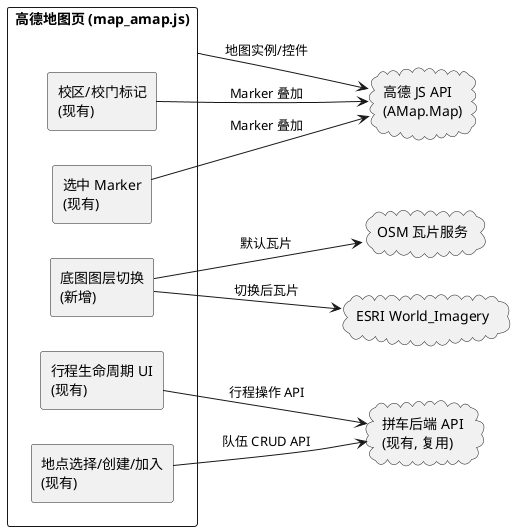
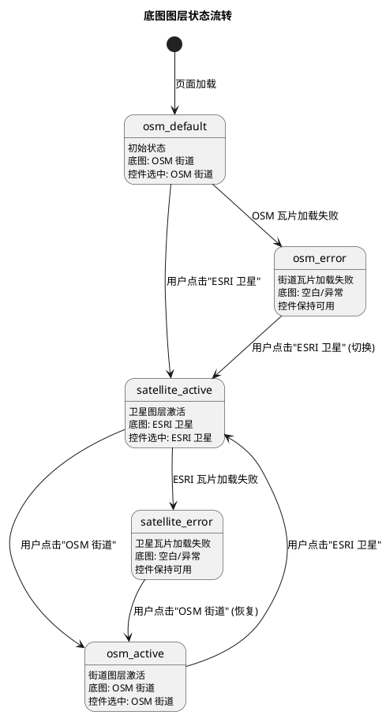
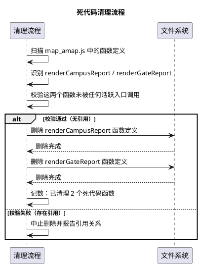
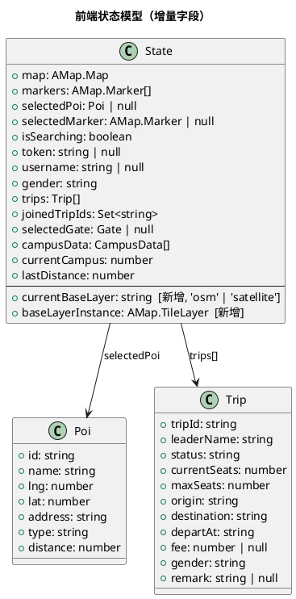
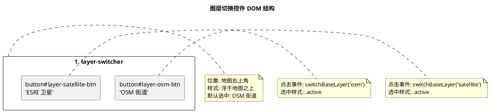

# 一、需求与存量功能关系分析

> **文档版本**：v2.0（基于高德版 map_amap.js 重写，反映项目当前状态）
>
> **需求总览**：spec.md 涵盖三大需求模块——
> - 模块 A（第 1-6 章）：行程生命周期操作入口 + 遗留死代码清理 + 底图图层切换
> - 模块 B（第 7 章）：高德地图迁移 Phase 2 原生 POI 地点选择与拼车业务接入
> - 模块 C（第 8 章）：Phase 2A 改进（逐级搜索 + 多类型覆盖）+ Phase 2B/2C 详细展开（两步确认 + 创建/加入队伍）
>
> **当前项目状态**：模块 B 与模块 C 的核心功能已在 `static/map_amap.js` 中实现并通过验收，首页入口已切换至 `/map_amap.html`。模块 A 中的行程生命周期操作已实现，**高德版底图图层切换**与**死代码清理**为本次增量设计的主要待完成项。

## 1.1 需求功能与存量功能对比

### 1.1.1 已实现功能

| 需求功能 | 存量功能 | 代码位置 | 匹配度 |
|---------|---------|---------|--------|
| 行程生命周期按钮动态显示（队长/乘客/游客按状态渲染） | `computeTripActions(trip)` 根据身份与状态返回按钮集合 | `static/map_amap.js:119-142` | 100% |
| 队长标记出发 | `departTripFromList(tripId)` → POST /api/trips/{id}/depart | `static/map_amap.js:177-179` | 100% |
| 队长标记完成 | `completeTripFromList(tripId)` → POST /api/trips/{id}/complete | `static/map_amap.js:182-184` | 100% |
| 队长取消队伍 | `cancelTripFromList(tripId)` → POST /api/trips/{id}/cancel | `static/map_amap.js:187-189` | 100% |
| 乘客退出队伍 | `leaveTripFromList(tripId)` → POST /api/trips/{id}/leave | `static/map_amap.js:192-199` | 100% |
| 游客加入队伍 | `joinTripFromList(tripId)` → POST /api/trips/{id}/join | `static/map_amap.js:201-211` | 100% |
| 操作反馈（成功刷新列表/失败保持弹窗） | `handleTripActionSuccess(data, tripId, keepOpen, successMsg)` | `static/map_amap.js:164-175` | 100% |
| 队伍详情弹窗展示 | `showTripDetail(t)` 渲染详情行与操作按钮 | `static/map_amap.js:144-162` | 100% |
| 已加入队伍 ID 持久化 | `loadJoinedTripIds()` / `saveJoinedTripIds()` → localStorage | `static/map_amap.js:213-229` | 100% |
| 高德地图初始化（3D 模式 + 控件） | `onAmapReady()` 初始化 AMap.Map + ToolBar/Scale/ControlBar | `static/map_amap.js:305-337` | 100% |
| 校区 POI 搜索与最佳候选选择 | `searchCampusPOI(campus)` + `selectBestCandidate()` | `static/map_amap.js:544-644` | 100% |
| 校门 POI 搜索与最佳候选选择 | `searchGatePOI(campus, campusResult)` + `selectBestGateCandidate()` | `static/map_amap.js:583-666` | 100% |
| 逐级扩大搜索（100m→300m→500m） | `findNearestAmapPoiWithFallback(lnglat)` + `SEARCH_RADIUS_LEVELS` | `static/map_amap.js:703-718` | 100% |
| 多类型 POI 覆盖搜索（十种类型） | `searchByPoiTypes(lnglat, radius)` + `POI_TYPE_LIST` | `static/map_amap.js:734-745` | 100% |
| 最近 POI 选择算法（距离排序 + 有效性校验 + 阈值校验） | `selectNearestValidPoi(pois, lnglat, radius)` | `static/map_amap.js:747-774` | 100% |
| 地图点击事件处理（含 isSearching 防抖） | `handleMapClick(event)` | `static/map_amap.js:776-809` | 100% |
| 选中地点 Marker 单例管理（高亮绿色水滴图标） | `setSelectedMarker(poi)` / `clearSelectedMarker()` / `initSelectedMarkerIcon()` | `static/map_amap.js:379-419` | 100% |
| 地点确认卡片（两步确认第一步） | `showPoiConfirmCard(poi, distance)` / `confirmPoiSelection()` / `reselectPoi()` | `static/map_amap.js:816-840` | 100% |
| 地点操作卡片（两步确认第二步） | `showPoiActionCard(poi)` / `hidePoiActionCard()` | `static/map_amap.js:421-432` | 100% |
| 未识别地点友好提示 | `showPoiNotFound()` / `hidePoiNotFound()` + `NOT_FOUND_MESSAGE` | `static/map_amap.js:434-442` | 100% |
| 创建队伍表单（目的地自动填充 POI.name 只读） | `openCreateTripModal()` / `submitCreateTrip()` | `static/map_amap.js:444-491` | 100% |
| 加入队伍列表（按目的地名称查询） | `openJoinTripModal()` / `renderJoinTripList(trips)` | `static/map_amap.js:493-527` | 100% |
| 游客进入机制（昵称/性别/令牌） | `initGuestOverlay()` / `showGuestOverlay()` / `hideGuestOverlay()` | `static/map_amap.js:231-282` | 100% |
| API 封装（Authorization 头 + 401 检测） | `api(path, opts)` | `static/map_amap.js:42-57` | 100% |
| 队伍列表刷新与渲染 | `refreshTrips()` / `renderTripList()` | `static/map_amap.js:66-95` | 100% |
| WGS84→GCJ02 坐标转换 | `convertWgs84ToAmap(lat, lng)` | `static/map_amap.js:842-853` | 100% |
| 距离计算与格式化 | `calcDistance(p1, p2)` / `formatDistance(meters)` | `static/map_amap.js:811-863` | 100% |
| 高德 JS API 加载与配置警告 | `initApp()` + `script.onerror` | `static/map_amap.js:284-303` | 100% |
| Leaflet 版底图图层切换（OSM 街道 + ESRI 卫星） | `initBaseLayerControl()` 使用 L.tileLayer + L.control.layers | `static/map.js:99-122` | 100% |
| 后端行程状态流转接口（depart/complete/cancel/leave） | `trips.depart/complete/cancel/leave` + `trip_service.change_status` | `app/api/trips.py:62-77` + `app/services/trip_service.py:155-168` | 100% |
| 后端队伍状态机（合法流转路径校验） | `TripStatus` 枚举 + `VALID_TRANSITIONS` + `can_transition()` | `app/models/domain.py:9-28` | 100% |
| 后端队伍创建接口 | `trips.create_trip` + `trip_service.create_trip` | `app/api/trips.py:26-29` + `app/services/trip_service.py:41-92` | 100% |
| 后端队伍搜索接口（按目的地过滤） | `trips.list_trips` + `trip_repo.search` | `app/api/trips.py:32-41` + `app/repositories/trip_repo.py:70-108` | 100% |
| 后端加入/退出队伍接口 | `trips.join_trip/leave_trip` + `trip_service.join_trip/leave_trip` | `app/api/trips.py:50-59` + `app/services/trip_service.py:105-152` | 100% |

### 1.1.2 需要扩展的功能

| 需求功能 | 存量功能 | 差异说明 | 扩展方向 |
|---------|---------|---------|---------|
| 高德版底图图层切换（OSM 街道 / ESRI 卫星） | Leaflet 版 `initBaseLayerControl()` 已实现 OSM + ESRI 切换（`static/map.js:99-122`） | Leaflet 版使用 `L.tileLayer` + `L.control.layers`，高德版使用 `AMap.Map` 原生底图，两者 API 完全不同。高德版 `map_amap.js` 目前仅有高德默认底图，无图层切换控件。spec 5.3 要求在地图页提供 OSM 街道与 ESRI 卫星切换。 | 在 `map_amap.js` 中新增 `initAmapLayerSwitcher()` 函数，通过高德瓦片图层（`AMap.TileLayer`）实现 OSM/ESRI 切换；在 `map_amap.html` 中新增图层切换 UI 控件；在 `map_amap.css` 中新增控件样式。切换时保留校区标记、校门标记、选中 Marker 等叠加层。 |
| 死代码清理（Phase 1 测试页遗留函数） | `renderCampusReport(campus, result)` / `renderGateReport(campus, result)`（`static/map_amap.js:865-926`） | 这两个函数为 Phase 1 测试页生成校区/校门搜索报告 HTML，在当前正式页面中未被任何活跃入口调用，属于遗留死代码。spec 5.2 要求清理遗留死代码文件。 | 删除 `map_amap.js` 中的 `renderCampusReport` 和 `renderGateReport` 函数（865-926 行），确认无其他引用后执行删除。 |

### 1.1.3 需要新增的功能或接口

#### 模块 A-1：高德版底图图层切换

| 功能点 | 输入 | 输出 | 核心逻辑 | 依赖关系 |
|-------|------|------|---------|---------|
| 图层切换控件初始化 | AMap.Map 实例 | 图层切换 UI 控件（含"OSM 街道"与"ESRI 卫星"两个选项） | 在地图右上角或指定位置渲染图层切换控件，默认选中"OSM 街道" | 依赖 `state.map`（高德地图实例） |
| 切换至 OSM 街道图层 | 用户点击"OSM 街道" | 地图底图切换为 OSM 街道瓦片 | 移除当前底图图层，加载 OSM 街道瓦片图层，叠加层保持不变 | 依赖 OpenStreetMap 瓦片服务 |
| 切换至 ESRI 卫星图层 | 用户点击"ESRI 卫星" | 地图底图切换为 ESRI 卫星影像瓦片 | 移除当前底图图层，加载 ESRI World_Imagery 瓦片图层，叠加层保持不变 | 依赖 ESRI ArcGIS Online 瓦片服务 |
| 叠加层保留 | 底图切换事件 | 校区标记/校门标记/选中 Marker 保持不变 | 切换底图时不调用 `clearMarkers()` 或 `clearSelectedMarker()`，仅替换底图瓦片层 | 依赖 `state.markers` / `state.selectedMarker` |
| 当前图层状态管理 | 图层切换事件 | `state.currentBaseLayer` 更新 | 维护当前底图图层标识（osm / satellite），初始值为 osm | 无外部依赖 |

#### 模块 A-2：死代码清理

| 功能点 | 输入 | 输出 | 核心逻辑 | 依赖关系 |
|-------|------|------|---------|---------|
| 死代码识别 | `map_amap.js` 源码 | 遗留死代码函数清单 | 扫描 `renderCampusReport` / `renderGateReport` 是否被任何活跃入口调用 | 无 |
| 死代码删除 | 遗留死代码函数清单 | 清理后的 `map_amap.js` | 删除未被引用的函数定义，确认不影响活跃功能 | 依赖活跃入口（handleMapClick、loadCampus 等） |

## 1.2 存量功能详细分析

### 1.2.1 行程生命周期操作（computeTripActions）

**接口契约**
- 入参：`trip` 对象（含 `tripId`、`leaderName`、`status`、`currentSeats`、`maxSeats` 字段）
- 出参：`actions` 数组，每项为 `{type, label}`，type ∈ {depart, complete, cancel, leave, join}
- 副作用：无（纯计算函数）

**业务规则**
1. 队长身份判定：`state.username === trip.leaderName`
2. 已加入判定：`state.joinedTripIds.has(trip.tripId)`
3. 队长操作按钮：待出发/已满员 → [标记出发, 取消队伍]；已出发 → [标记完成]；终态 → []
4. 乘客退出按钮：已加入 + 待出发/已满员 → [退出队伍]；其他 → []
5. 加入按钮：未加入 + 待出发 + 有座位 → [加入队伍]；其他 → []

**约束**
- 按钮渲染仅为交互引导，最终权限由后端 `trip_service.change_status` 校验
- 终态队伍（已完成/已取消）不渲染任何操作按钮

### 1.2.2 行程操作执行（departTripFromList / completeTripFromList / cancelTripFromList / leaveTripFromList / joinTripFromList）

**接口契约**
- 入参：`tripId` 字符串
- 出参：无（异步操作，通过 `handleTripActionSuccess` 反馈）
- 副作用：调用后端 API，更新 `state.trips`、`state.joinedTripIds`，刷新队伍列表

**业务规则**
1. 调用对应后端接口（POST /api/trips/{id}/depart|complete|cancel|leave|join）
2. 成功（code === 0）：提示成功、刷新队伍列表、根据 `keepOpen` 决定弹窗保持或关闭
3. 失败（code !== 0）：在弹窗内展示 `data.message` 错误提示，弹窗保持打开
4. leave/join 成功时同步更新 `state.joinedTripIds` 并持久化到 localStorage

**扩展点**
- `handleTripActionSuccess` 的 `keepOpen` 参数控制弹窗行为：depart/complete 保持打开（更新详情），cancel/leave 关闭弹窗

### 1.2.3 逐级扩大搜索（findNearestAmapPoiWithFallback）

**接口契约**
- 入参：`lnglat` 对象（含 `lng`、`lat` 数值字段，或高德 LngLat 对象）
- 出参：POI 对象 `{id, name, lng, lat, address, type, distance}` 或 `null`
- 副作用：发起最多 3 轮 PlaceSearch 网络请求

**业务规则**
1. 半径序列固定为 `[100, 300, 500]`（`SEARCH_RADIUS_LEVELS` 常量）
2. 每级先空关键词搜索，无有效结果时按 `POI_TYPE_LIST` 十种类型依次搜索
3. 某级返回有效 POI 时立即停止后续级别搜索
4. 有效 POI 校验：`location` 存在 + `name` 非空 + `id` 存在 + 经纬度为数值
5. 选取距离点击位置最近的有效 POI，距离超过当前半径则视为无效

**约束**
- `isSearching` 防抖：搜索进行中忽略后续点击
- 所有异常捕获后返回 `null`，不抛出技术错误

### 1.2.4 两步确认流程（showPoiConfirmCard → confirmPoiSelection → showPoiActionCard）

**接口契约**
- 第一步：`showPoiConfirmCard(poi, distance)` → 显示确认卡片（名称/地址/类型/距离/来源）
- 确认：`confirmPoiSelection()` → 隐藏确认卡片，显示操作卡片
- 重新选择：`reselectPoi()` → 隐藏确认卡片，清除选中 Marker
- 第二步：`showPoiActionCard(poi)` → 显示操作卡片（创建队伍/加入其他队伍）

**业务规则**
1. 找到 POI 后先显示确认卡片，不直接进入操作
2. 确认后才显示操作卡片，提供创建/加入入口
3. 重新选择或关闭时清除选中 Marker，恢复地图可点击状态
4. 同一时刻仅存在一个选中 Marker

### 1.2.5 创建队伍接入（openCreateTripModal / submitCreateTrip）

**接口契约**
- 入参：无（从 `state.selectedPoi`、`state.selectedGate`、表单字段获取数据）
- 出参：无（异步操作，成功后关闭弹窗并刷新列表）
- 副作用：调用 POST /api/trips，更新 `state.trips`

**业务规则**
1. 目的地自动填充为 `state.selectedPoi.name`，只读
2. 出发地自动填充为校区名 + 入口名
3. 提交时 destination = poi.name、destinationLat = poi.lat、destinationLng = poi.lng
4. 成功后关闭弹窗、提示成功、刷新队伍列表
5. 失败时在弹窗内展示错误，弹窗保持打开

**约束**
- 复用现有 POST /api/trips 接口，不新增后端接口
- 不重建数据库，至少保存目的地名称与经纬度

### 1.2.6 加入队伍接入（openJoinTripModal / renderJoinTripList / joinTripFromList）

**接口契约**
- 入参：无（从 `state.selectedPoi.name` 获取查询条件）
- 出参：无（异步操作，成功后关闭弹窗并刷新列表）
- 副作用：调用 GET /api/trips?destination= + POST /api/trips/{id}/join，更新 `state.trips`、`state.joinedTripIds`

**业务规则**
1. 按 `state.selectedPoi.name` 查询相同目的地的队伍
2. 可加入条件：状态为"待出发"且 `currentSeats < maxSeats`
3. 加入成功后：提示成功、关闭弹窗、`joinedTripIds.add(tripId)`、持久化、刷新列表
4. 加入失败时在弹窗内展示错误，弹窗保持打开
5. 空列表时展示"该地点暂无队伍，点击「创建队伍」发起一个吧"

**约束**
- 复用现有 GET /api/trips 与 POST /api/trips/{id}/join 接口
- 保留后端业务规则校验（不能加入自己/重复加入/性别匹配/满员校验）

### 1.2.7 Leaflet 版底图图层切换（initBaseLayerControl）

**接口契约**
- 入参：无（从 `state.map` 获取 Leaflet 地图实例）
- 出参：`{osmLayer, satelliteLayer}` 两个瓦片图层实例
- 副作用：在地图上添加图层切换控件

**业务规则**
1. 创建 OSM 街道瓦片图层（`L.tileLayer` + OpenStreetMap 标准 URL）并设为默认
2. 创建 ESRI 卫星瓦片图层（`L.tileLayer` + ArcGIS World_Imagery URL）
3. 使用 `L.control.layers` 添加图层切换控件至右上角

**约束**
- 仅适用于 Leaflet 版地图页（`map.js`），高德版需另行实现
- 切换底图时 Leaflet 自动保留叠加层（Marker、Polygon、Circle 等）

### 1.2.8 高德地图初始化（onAmapReady）

**接口契约**
- 入参：无（高德 JS API 加载完成后触发）
- 出参：无（初始化 `state.map` 及所有地图交互）
- 副作用：创建 AMap.Map 实例，添加控件，绑定点击事件，加载校区数据

**业务规则**
1. 创建 AMap.Map 实例（zoom:17, viewMode:3D, pitch:55, rotation:-15）
2. 添加 ToolBar（RT 位置）、Scale、ControlBar 控件
3. 绑定 `map.on("click", handleMapClick)` 点击事件
4. 加载校区列表与首个校区数据
5. 根据会话状态显示/隐藏游客遮罩

**扩展点**
- 控件添加后（第 319 行）为新增图层切换控件的插入位置
- `state.map` 创建后即为图层切换的基底实例

### 1.2.9 死代码函数引用关系

**renderCampusReport(campus, result)**（`static/map_amap.js:865-893`）
- 功能：生成校区 POI 搜索报告 HTML（含 POI ID、坐标、地址、候选列表）
- 引用情况：在当前 `map_amap.js` 中无任何调用点，为 Phase 1 测试页遗留函数
- 约束：删除前需确认无其他文件引用

**renderGateReport(campus, result)**（`static/map_amap.js:895-926`）
- 功能：生成校门 POI 搜索报告 HTML（含校门名称、坐标、匹配关键词、搜索记录）
- 引用情况：在当前 `map_amap.js` 中无任何调用点，为 Phase 1 测试页遗留函数
- 约束：删除前需确认无其他文件引用

**活跃入口引用链**
- `initApp()` → `onAmapReady()` → `renderCampusList()` / `loadCampus()` / `handleMapClick()` / `refreshTrips()`
- `handleMapClick()` → `findNearestAmapPoiWithFallback()` → `showPoiConfirmCard()` → `confirmPoiSelection()` → `showPoiActionCard()` → `openCreateTripModal()` / `openJoinTripModal()`
- 以上活跃链均不涉及 `renderCampusReport` / `renderGateReport`
# 二、增量设计方案

> **设计范围**：本次增量设计聚焦于 spec.md 中尚未在高德版 `map_amap.js` 中实现的两个需求模块：
> 1. **高德版底图图层切换**（spec 5.3）：在 `/map_amap.html` 页面新增 OSM 街道 / ESRI 卫星底图切换能力
> 2. **死代码清理**（spec 5.2）：删除 Phase 1 测试页遗留的 `renderCampusReport` / `renderGateReport` 函数
>
> **不修改范围**（继承 spec 7.7 与 8.7 约束清单）：
> - 不修改后端 API（`app/` 目录）
> - 不重建数据库（SQLite schema 不变）
> - 不修改 Leaflet 版地图页（`static/map.html`、`static/map.js`、`static/map.css`）
> - 不修改论坛模块（`static/forum.html`、`static/forum.js`、`static/forum.css`）
> - 不修改游客进入机制
> - 不删除 `osm_pois.json`
> - 优先仅修改 `static/map_amap.js`、`static/map_amap.css`、`static/map_amap.html`

## 2.1 实现模型

### 2.1.1 上下文视图



**说明**：本次增量仅在高德地图页前端新增底图图层切换模块，后端 API 全部复用现有接口。图层切换模块与现有校区标记、选中 Marker、行程操作等模块解耦，切换底图时不影响叠加层。

### 2.1.2 服务/组件总体架构

```plantuml
@startuml
package "static/map_amap.js" {
  component "initAmapLayerSwitcher\n[新增]" as IALS : 初始化图层切换控件
  component "switchBaseLayer\n[新增]" as SBL : 切换底图图层
  component "createOSMTileLayer\n[新增]" as COT : 创建 OSM 瓦片层
  component "createESRITileLayer\n[新增]" as CET : 创建 ESRI 卫星瓦片层
  component "onAmapReady\n[现有]" as OAR : 地图初始化
  component "loadCampus\n[现有]" as LC2 : 校区加载/标记
  component "handleMapClick\n[现有]" as HMC : 点击/选中 Marker
  component "showTripDetail\n[现有]" as STD : 队伍详情/行程操作
}

package "state [新增字段]" {
  component "currentBaseLayer\n[新增] : 'osm' | 'satellite'" as CBL
  component "baseLayerInstance\n[新增] : AMap.TileLayer" as BLI
}

package "static/map_amap.html [新增 UI]" {
  component "layer-switcher\n[新增] : 图层切换控件" as LSW
}

package "static/map_amap.css [新增样式]" {
  component "layer-switcher 样式\n[新增]" as LSS
}

OAR --> IALS : 初始化时调用
IALS --> LSW : 渲染控件
IALS --> CBL : 设置初始值 'osm'
IALS --> COT : 创建默认 OSM 层
COT --> BLI : 存储瓦片层实例
LSW --> SBL : 用户点击切换
SBL --> CET : 创建 ESRI 层(如需)
SBL --> BLI : 替换当前瓦片层
SBL --> CBL : 更新当前图层标识
SBL ..> MK : 不影响(叠加层保留)
SBL ..> SM : 不影响(叠加层保留)
@enduml
```

**模块划分**：

| 模块 | 职责 | 改动类型 | 文件 |
|------|------|---------|------|
| 底图图层切换控件 | 提供 OSM/ESRI 切换 UI 与交互 | 新增 | `map_amap.html` + `map_amap.css` |
| 底图图层管理 | 创建/切换/销毁瓦片图层，维护当前图层状态 | 新增 | `map_amap.js` |
| 死代码清理 | 删除遗留的测试报告函数 | 删除 | `map_amap.js` |
| 现有地图初始化 | 在初始化流程中调用图层切换控件初始化 | 修改（追加一行调用） | `map_amap.js` |

### 2.1.3 实现设计文档

#### 底图图层切换状态流转



**状态说明**：
- 初始状态为 `osm_default`，默认加载 OSM 街道图层
- 用户点击切换控件在 OSM 与 ESRI 之间切换
- 瓦片加载失败时控件保持可用，允许用户切回正常图层
- 切换时不触发 `clearMarkers()` / `clearSelectedMarker()`，叠加层保持不变

#### 死代码清理流程



## 2.2 接口设计

### 2.2.1 总体设计

| 接口分类 | 接口名称 | 类型 | 稳定性 | 改动类型 |
|---------|---------|------|--------|---------|
| 底图图层管理 | `initAmapLayerSwitcher()` | 前端函数 | 稳定 | 新增 |
| 底图图层管理 | `switchBaseLayer(layer)` | 前端函数 | 稳定 | 新增 |
| 底图图层管理 | `createOSMTileLayer()` | 前端函数 | 稳定 | 新增 |
| 底图图层管理 | `createESRITileLayer()` | 前端函数 | 稳定 | 新增 |
| 死代码清理 | `renderCampusReport(campus, result)` | 前端函数 | 废弃 | 删除 |
| 死代码清理 | `renderGateReport(campus, result)` | 前端函数 | 废弃 | 删除 |

**接口变更策略**：
- 新增函数挂载到全局作用域（与现有 `onAmapReady`、`handleMapClick` 等同级）
- 删除函数为未引用的死代码，删除不影响任何活跃功能
- 不涉及后端接口变更

### 2.2.2 接口清单

#### initAmapLayerSwitcher()

**接口签名**
```javascript
function initAmapLayerSwitcher()
```

**业务说明**：初始化高德版底图图层切换控件，创建默认 OSM 街道瓦片图层并添加到地图，渲染图层切换 UI 控件。在 `onAmapReady()` 中地图实例创建后调用。

**前置条件**：
- `state.map` 已初始化为 `AMap.Map` 实例
- `map_amap.html` 中存在 `#layer-switcher` DOM 元素

**后置条件**：
- `state.currentBaseLayer` 设置为 `"osm"`
- `state.baseLayerInstance` 设置为 OSM 瓦片图层实例
- `#layer-switcher` 控件可见，含"OSM 街道"与"ESRI 卫星"两个选项
- "OSM 街道"选项默认选中

**异常映射**：
- 高德 `AMap.TileLayer` 初始化异常 → `console.error` 记录日志，地图保持高德默认底图，控件不显示
- OSM 瓦片加载失败 → `tileerror` 事件监听，`console.warn` 记录前 5 次失败 URL，地图显示空白区域但控件保持可用

**调用示例**
```javascript
// 在 onAmapReady() 中，地图实例创建后调用
function onAmapReady() {
  state.map = new AMap.Map("map", { /* ... */ });
  state.map.addControl(new AMap.ToolBar({ position: "RT" }));
  state.map.addControl(new AMap.Scale());
  state.map.addControl(new AMap.ControlBar({ position: { top: "10px", left: "10px" } }));
  initAmapLayerSwitcher();  // 新增：初始化图层切换
  renderCampusList();
  loadCampus(0);
  // ...
}
```

#### switchBaseLayer(layer)

**接口签名**
```javascript
function switchBaseLayer(layer)
```

**业务说明**：切换地图底图图层。移除当前底图瓦片图层，创建并添加目标图层瓦片，更新状态。切换时保留所有叠加层（校区标记、校门标记、选中 Marker）。

**前置条件**：
- `state.map` 已初始化
- `layer` 参数为 `"osm"` 或 `"satellite"`

**后置条件**：
- `state.currentBaseLayer` 更新为目标图层标识
- `state.baseLayerInstance` 更新为目标瓦片图层实例
- 地图底图显示为目标图层瓦片
- 叠加层（`state.markers`、`state.selectedMarker`）保持不变

**异常映射**：
- 瓦片创建异常 → `console.error` 记录日志，保持当前底图不变
- 瓦片加载失败 → `tileerror` 事件监听，控件保持可用，允许用户切回

**调用示例**
```javascript
// 用户点击"ESRI 卫星"按钮
document.getElementById("layer-satellite-btn").addEventListener("click", function () {
  switchBaseLayer("satellite");
});

// 用户点击"OSM 街道"按钮
document.getElementById("layer-osm-btn").addEventListener("click", function () {
  switchBaseLayer("osm");
});
```

#### createOSMTileLayer()

**接口签名**
```javascript
function createOSMTileLayer()
```

**业务说明**：创建 OSM 街道瓦片图层实例，使用 OpenStreetMap 标准瓦片服务 URL。

**前置条件**：高德 JS API 已加载，`AMap.TileLayer` 可用

**后置条件**：返回 `AMap.TileLayer` 实例，未添加到地图

**调用示例**
```javascript
function createOSMTileLayer() {
  return new AMap.TileLayer({
    tileUrl: "https://tile.openstreetmap.org/{z}/{x}/{y}.png",
    zIndex: 0
  });
}
```

#### createESRITileLayer()

**接口签名**
```javascript
function createESRITileLayer()
```

**业务说明**：创建 ESRI 卫星影像瓦片图层实例，使用 ArcGIS Online World_Imagery 服务 URL。

**前置条件**：高德 JS API 已加载，`AMap.TileLayer` 可用

**后置条件**：返回 `AMap.TileLayer` 实例，未添加到地图

**调用示例**
```javascript
function createESRITileLayer() {
  return new AMap.TileLayer({
    tileUrl: "https://server.arcgisonline.com/ArcGIS/rest/services/World_Imagery/MapServer/tile/{z}/{y}/{x}",
    zIndex: 0
  });
}
```

## 2.3 数据模型

### 2.3.1 设计目标

**需要支持的业务场景**：
1. 用户在高德地图页切换底图图层（OSM 街道 ↔ ESRI 卫星）
2. 切换后叠加层保持不变，用户可继续查看校区标记、选中地点、队伍列表
3. 滨海校区用户可切换至卫星图层查看真实地表影像

**性能、容量、扩展性目标**：
- 图层切换响应时间 ≤ 3 秒（含新图层首屏瓦片渲染）
- 切换操作不导致地图卡顿或叠加层丢失
- 控件设计支持未来扩展更多图层类型

**与存量数据的兼容策略**：
- 不新增后端数据字段
- 不修改数据库 schema
- 前端状态新增 `currentBaseLayer` 和 `baseLayerInstance` 字段，不影响现有状态

### 2.3.2 模型实现



**对象关系说明**：
- `State` 为前端全局状态对象，新增 `currentBaseLayer`（当前底图标识）和 `baseLayerInstance`（当前瓦片图层实例）两个字段
- `currentBaseLayer` 取值范围为 `"osm"`（OSM 街道）和 `"satellite"`（ESRI 卫星），初始值为 `"osm"`
- `baseLayerInstance` 为高德 `AMap.TileLayer` 实例，用于在切换时移除旧图层
- 现有字段（`markers`、`selectedMarker`、`selectedPoi` 等）在底图切换时保持不变

**对象生命周期**：
- `currentBaseLayer` / `baseLayerInstance` 在 `initAmapLayerSwitcher()` 中创建，页面卸载时销毁
- 瓦片图层实例在 `switchBaseLayer()` 中创建新实例并移除旧实例，避免内存泄漏

**持久化策略**：
- `currentBaseLayer` 不持久化到 localStorage，每次页面加载默认为 `"osm"`（spec 5.3.1 规则 1 要求默认 OSM 街道）
- 不涉及后端数据持久化

### 2.3.3 图层切换控件 UI 模型



**控件交互规则**：
1. 控件浮于地图右上角，不遮挡地图核心区域
2. 两个按钮互斥选中，点击一个按钮时另一个取消选中
3. 当前选中按钮添加 `.active` CSS 类，视觉高亮
4. 控件支持鼠标悬停效果，增强可点击感知
5. 控件在地图加载失败时不显示（与 `#config-warning` 互斥）

## 2.4 方案决策记录

| 决策点 | 选项 | 选择 | 理由 |
|-------|------|------|------|
| 高德版瓦片图层实现方式 | A. 使用 `AMap.Map.setMapStyle` 切换高德内置样式 / B. 使用 `AMap.TileLayer` 加载外部瓦片 | B | spec 5.3 要求 OSM 街道与 ESRI 卫星两种底图，这两种瓦片来源均为外部服务，非高德内置样式。`AMap.TileLayer` 支持自定义瓦片 URL，可加载 OSM 与 ESRI 瓦片。 |
| 图层切换控件 UI | A. 使用高德内置控件 / B. 自定义 HTML 控件 | B | 高德 JS API 2.0 无内置图层切换控件（不同于 Leaflet 的 `L.control.layers`）。自定义 HTML 控件可精确控制样式与交互，与现有 UI 风格一致。 |
| 控件位置 | A. 地图左上角 / B. 地图右上角 / C. 侧边栏内 | B | 高德 ToolBar 已在右上角（RT），ControlBar 在左上角。图层切换控件放右上角与 ToolBar 区域协调，不遮挡左侧栏。 |
| 默认底图 | A. 高德默认底图 / B. OSM 街道 | B | spec 5.3.1 规则 1 要求默认显示 OSM 街道图层，保持现有地图外观不变。 |
| 叠加层保留策略 | A. 切换时清除并重建 / B. 切换时保持不变 | B | spec 5.3.1 规则 3 要求切换时叠加层保持不变。高德 `AMap.TileLayer` 仅替换底图瓦片，不影响 Marker 叠加层，天然满足此要求。 |
| 瓦片加载失败处理 | A. 自动切回 OSM / B. 保持当前状态，控件可用 | B | spec 5.3.3 异常 1 要求卫星瓦片加载失败时保留控件可用，允许用户手动切回。B 给予用户控制权，避免自动切换干扰用户操作。 |
| 死代码清理范围 | A. 仅删除函数定义 / B. 删除函数定义并清理相关 CSS | A | `renderCampusReport` / `renderGateReport` 为纯 JS 函数，生成 HTML 字符串，无对应专属 CSS 类。相关 CSS 类（如 `.report-section`、`.report-row`）可能被其他地方使用，保守起见仅删除函数定义。 |
| currentBaseLayer 持久化 | A. 持久化到 localStorage / B. 不持久化，每次默认 OSM | B | spec 5.3.1 规则 1 要求默认显示 OSM 街道图层。不持久化确保每次加载符合 spec 要求。用户切换为临时操作，不跨会话保留。 |
| ESRI 瓦片 URL 格式 | A. `{z}/{x}/{y}` / B. `{z}/{y}/{x}` | B | ESRI ArcGIS World_Imagery 瓦片 URL 格式为 `tile/{z}/{y}/{x}`（y 在 x 前），与 OSM 的 `{z}/{x}/{y}` 不同。Leaflet 版 `map.js:108` 已使用正确格式。 |

## 2.5 异常处理设计

### 2.5.1 底图图层切换异常

| 异常场景 | 触发条件 | 前端处理 | 用户感知 | 对应 spec |
|---------|---------|---------|---------|-----------|
| OSM 瓦片加载失败 | OpenStreetMap 服务不可达或返回错误瓦片 | `tileerror` 事件监听，`console.warn` 记录失败 URL（前 5 次） | 地图区域出现空白，控件保持可用，可切换至 ESRI 卫星 | spec 5.3.3 异常 1 |
| ESRI 卫星瓦片加载失败 | ESRI ArcGIS Online 服务不可达或返回错误瓦片 | `tileerror` 事件监听，`console.warn` 记录失败 URL | 卫星区域出现空白或加载失败标记，可手动切回 OSM 街道 | spec 5.3.3 异常 1 |
| 图层切换控件初始化失败 | `AMap.TileLayer` 初始化异常或 DOM 元素缺失 | `try-catch` 捕获异常，`console.error` 记录日志，地图以高德默认底图工作 | 地图正常显示高德默认底图，但无图层切换控件 | spec 5.3.3 异常 2 |
| 高德 JS API 加载失败 | 网络问题或 Key 配置错误 | 现有 `initApp()` 中 `script.onerror` 已处理，显示配置警告 | 页面显示"高德 JS API 加载失败"警告及配置指引 | spec 5.3.3 异常 2 |

### 2.5.2 死代码清理异常

| 异常场景 | 触发条件 | 处理方式 | 用户感知 |
|---------|---------|---------|---------|
| 发现活跃引用 | 清理前校验发现某活跃入口仍引用目标函数 | 中止删除，输出引用关系报告 | 开发者收到"函数仍被引用，已中止清理"提示 |
| 函数删除失败 | 文件权限不足或文件被占用 | 捕获异常，跳过该函数并继续处理其余 | 开发者收到"部分函数删除失败"提示 |

## 2.6 集成点与改动清单

### 2.6.1 文件改动清单

| 文件 | 改动类型 | 改动内容 | 行数估计 |
|------|---------|---------|---------|
| `static/map_amap.js` | 新增 | `initAmapLayerSwitcher()` / `switchBaseLayer()` / `createOSMTileLayer()` / `createESRITileLayer()` 函数；`state` 新增 `currentBaseLayer` / `baseLayerInstance` 字段；`onAmapReady()` 中追加 `initAmapLayerSwitcher()` 调用 | +60 行 |
| `static/map_amap.js` | 删除 | `renderCampusReport()` / `renderGateReport()` 函数（865-926 行） | -62 行 |
| `static/map_amap.html` | 新增 | `#layer-switcher` 图层切换控件 DOM（含两个按钮） | +8 行 |
| `static/map_amap.css` | 新增 | `.layer-switcher` 及子元素样式（定位、按钮、选中态、悬停效果） | +30 行 |

### 2.6.2 集成点

| 集成点 | 现有代码位置 | 改动方式 |
|-------|-------------|---------|
| `onAmapReady()` | `static/map_amap.js:305-337` | 在 `state.map.addControl(new AMap.ControlBar(...))` 之后追加 `initAmapLayerSwitcher()` 调用 |
| `state` 对象定义 | `static/map_amap.js:23-38` | 新增 `currentBaseLayer: "osm"` 和 `baseLayerInstance: null` 两个字段 |
| `#map-container` | `static/map_amap.html:41-80` | 在 `#map` div 之后、`#poi-confirm-card` 之前追加 `#layer-switcher` 控件 DOM |

### 2.6.3 不修改范围确认

| 文件/模块 | 是否修改 | 理由 |
|----------|---------|------|
| `app/` 目录（后端） | 否 | spec 5.1.4 规则 1、spec 7.7 规则 1、spec 8.7 规则 1 约束 |
| SQLite schema | 否 | spec 7.7 规则 2、spec 8.7 规则 2 约束 |
| `static/map.html` / `map.js` / `map.css` | 否 | spec 7.7 规则 3、spec 8.7 规则 3 约束，Leaflet 版保留备用 |
| `static/forum.html` / `forum.js` / `forum.css` | 否 | spec 7.7 规则 4、spec 8.7 规则 4 约束 |
| 游客进入机制 | 否 | spec 7.7 规则 5、spec 8.7 规则 5 约束 |
| `data/osm_pois.json` | 否 | spec 7.7 规则 6、spec 8.7 规则 6 约束 |
| `static/index.html` | 否 | 首页入口已切换至 `/map_amap.html`，无需再改 |

## 2.7 验收对照

### 2.7.1 底图图层切换验收（spec 5.3）

| spec 验收条件 | 设计方案对应 | 状态 |
|--------------|-------------|------|
| 地图页首次加载 → 底图为 OSM 街道图层 | `initAmapLayerSwitcher()` 默认创建 OSM 瓦片层，`state.currentBaseLayer = "osm"` | 待实现 |
| 地图页加载完成 → 显示图层切换控件，含"OSM 街道"与"ESRI 卫星"两个选项 | `#layer-switcher` DOM + `initAmapLayerSwitcher()` 渲染控件 | 待实现 |
| 用户选择"ESRI 卫星" → 底图切换为 ESRI 卫星影像图层 | `switchBaseLayer("satellite")` → `createESRITileLayer()` | 待实现 |
| 用户选择"OSM 街道" → 底图切换回 OSM 街道图层 | `switchBaseLayer("osm")` → `createOSMTileLayer()` | 待实现 |
| 用户切换底图 → 所有校区标记、POI 标记、边界多边形、范围圆均保留且位置正确 | `switchBaseLayer()` 仅替换瓦片层，不调用 `clearMarkers()` / `clearSelectedMarker()` | 待实现 |
| 用户在卫星图层下查看滨海校区区域 → 可见真实地表影像而非水域色块 | ESRI World_Imagery 提供真实卫星影像 | 待实现 |
| 地图页加载 → 默认底图为 OSM 街道，ESRI 卫星仅作为可选切换项 | `state.currentBaseLayer` 初始值 `"osm"`，不持久化 | 待实现 |
| 卫星瓦片加载失败 → 控件保持可用，允许切回 OSM | `tileerror` 事件监听，不自动切换，控件保持可用 | 待实现 |

### 2.7.2 死代码清理验收（spec 5.2）

| spec 验收条件 | 设计方案对应 | 状态 |
|--------------|-------------|------|
| 执行清理 → 指定的死代码函数被删除 | 删除 `renderCampusReport` / `renderGateReport` | 待实现 |
| 活跃页面均未引用目标函数 → 执行删除 | 校验 `handleMapClick` / `loadCampus` 等活跃入口不引用这两个函数 | 待实现 |
| 清理后通过浏览器请求旧版功能 → 不再可用 | 函数删除后无法调用，不影响活跃功能 | 待实现 |
| 清理操作 → 仅清理范围内的函数被删除，其他保持不变 | 仅删除 `renderCampusReport` / `renderGateReport`，不删除其他 | 待实现 |

### 2.7.3 行程生命周期操作验收（spec 5.1，已实现）

| spec 验收条件 | 现有实现 | 状态 |
|--------------|---------|------|
| 队长+待出发 → 显示"标记出发""取消队伍" | `computeTripActions:124-130` | 已实现 |
| 队长+已满员 → 显示"标记出发""取消队伍" | `computeTripActions:124-130` | 已实现 |
| 队长+已出发 → 显示"标记完成" | `computeTripActions:127-129` | 已实现 |
| 队长+终态 → 不显示任何操作按钮 | `computeTripActions:130` 返回空数组 | 已实现 |
| 已加入乘客+待出发/已满员 → 显示"退出队伍" | `computeTripActions:132-136` | 已实现 |
| 未加入+待出发+有座位 → 显示"加入队伍" | `computeTripActions:138-140` | 已实现 |
| 操作成功 → 提示成功、刷新列表、弹窗更新 | `handleTripActionSuccess:164-175` | 已实现 |
| 操作失败 → 弹窗内展示错误，弹窗保持打开 | `handleTripActionSuccess:165` | 已实现 |

---

> **增量设计结束。** 以上为基于 spec.md 当前状态的增量技术实现方案，聚焦于高德版底图图层切换（spec 5.3）与死代码清理（spec 5.2）两个待完成需求模块。行程生命周期操作（spec 5.1）与高德地图迁移 Phase 2 全部功能（spec 7-8）已在 `static/map_amap.js` 中实现并通过验收，本次设计不涉及这些已实现功能的改动。