# **1. 组件定位**

## **1.1 核心职责**
本组件负责补全校园拼车平台地图页的行程生命周期操作入口、清理遗留死代码文件、以及新增底图图层切换能力，实现行程全流程可操作、界面无冗余、滨海校区可辨识。

## **1.2 核心输入**
1. 用户在地图页队伍详情弹窗中触发的操作指令：标记出发、标记完成、取消队伍、退出队伍。
2. 当前登录用户的会话身份（用户名、性别、令牌）。
3. 用户在地图页触发的底图图层切换指令（OSM 街道 / ESRI 卫星）。
4. 队伍列表数据（含队长名、当前状态、座位数等字段）。

## **1.3 核心输出**
1. 队伍详情弹窗中根据身份与状态动态渲染的操作按钮集合。
2. 行程状态流转操作后返回给用户的成功提示或错误提示。
3. 操作成功后刷新的队伍列表视图。
4. 地图底图根据用户选择切换后的可视图层。
5. 清理死代码后，旧版界面文件不再可通过静态路径访问。

## **1.4 职责边界**
1. 本组件不负责新增或修改任何后端 API，所有行程状态流转接口已就绪，仅做前端对接。
2. 本组件不负责队伍的创建、加入流程改造（已有功能保持不变）。
3. 本组件不负责论坛、评论、点赞等其他模块的任何改动。
4. 本组件不负责滨海校区边界数据的采集与更新，仅提供底图切换手段供用户辨识。
5. 本组件不负责用户注册/登录体系改造，沿用现有游客进入机制。

# **2. 领域术语**

**队长**
: 拼车队伍的创建者，拥有对所属队伍执行标记出发、标记完成、取消队伍的独占权限。

**乘客**
: 已加入某队伍且非队长的成员，拥有退出已加入队伍的权限。

**行程状态**
: 队伍在其生命周期中所处的阶段，取值包括：待出发、已满员、已出发、已完成、已取消。
: 备注：待出发与已满员为可操作态，已出发仅可完成，已完成与已取消为终态。

**状态流转**
: 队伍从一个行程状态变更为另一个行程状态的过程，须遵循预定义的合法流转路径。

**死代码**
: 项目中存在但未被任何活跃入口引用、不再承担业务功能的遗留文件。

**底图图层**
: 地图底部的瓦片渲染来源，本组件支持 OSM 街道图层与 ESRI 卫星图层两种。

**滨海校区**
: 2024 年 9 月建成的新校区，在 OSM 瓦片上仍显示为水域，需借助卫星图层查看真实地表。

# **3. 角色与边界**

## **3.1 核心角色**
- 队长：创建队伍的用户，可在队伍详情弹窗中看到并执行标记出发、标记完成、取消队伍操作。
- 乘客：已加入队伍的非队长用户，可在队伍详情弹窗中看到并执行退出队伍操作。
- 游客：已通过游客进入机制登录的任意用户，可切换地图底图图层、查看队伍详情。

## **3.2 外部系统**
- 拼车后端 API：提供行程状态流转接口（标记出发、标记完成、取消队伍、退出队伍），本组件通过 HTTP 调用对接。
- OpenStreetMap 瓦片服务：提供街道底图瓦片，作为默认底图来源。
- ESRI ArcGIS Online 卫星瓦片服务：提供卫星影像底图，作为滨海校区辨识的备选底图来源。

## **3.3 交互上下文**
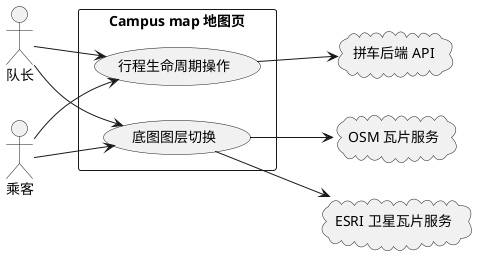

# **4. DFX约束**

## **4.1 性能**
1. 行程状态流转操作（标记出发/标记完成/取消队伍/退出队伍）的端到端响应时间不得超过 2 秒（含网络往返与列表刷新）。
2. 底图图层切换后，新图层首屏瓦片渲染完成时间不得超过 3 秒（正常网络条件下）。
3. 死代码清理操作不产生运行时开销（为一次性文件删除）。

## **4.2 可靠性**
1. 行程操作失败时，必须向用户明确展示错误原因，且不得使队伍列表或弹窗进入不一致状态。
2. 底图图层切换不得导致已绘制的校区标记、POI 标记、队伍范围圆丢失或错位。
3. 卫星瓦片加载失败时，须保留图层切换控件可用，允许用户切回 OSM 街道图层。

## **4.3 安全性**
1. 行程状态流转操作须携带当前用户会话令牌进行鉴权，前端不得绕过后端权限校验。
2. 前端按钮的显示/隐藏仅为交互引导，最终操作权限以后端校验结果为准。

## **4.4 可维护性**
1. 前端函数命名须使用 camelCase（如 showTripDetail、departTrip、leaveTrip、switchBaseLayer）。
2. 新增交互逻辑须在浏览器控制台输出关键操作日志，便于排查。
3. 死代码清理后，项目文件结构须保持清晰，不得引入新的未引用文件。

## **4.5 兼容性**
1. 底图图层切换功能须兼容 Leaflet 1.9.4 已有控件体系，不得破坏现有地图交互。
2. 行程生命周期按钮的引入不得影响现有"加入队伍"按钮的行为与样式。
3. 死代码清理不得影响 index.html、map.html、forum.html 等活跃页面的正常加载。

# **5. 核心能力**

## **5.1 行程生命周期操作**

### **5.1.1 业务规则**
1. **按钮动态显示规则**：队伍详情弹窗须根据当前用户身份与队伍状态动态渲染操作按钮，不同身份在不同状态下可见的按钮集合不同。
a. 验收条件：[当前用户为队长且队伍状态为"待出发"] → [弹窗显示"标记出发""取消队伍"按钮，不显示"标记完成""退出队伍"按钮]
b. 验收条件：[当前用户为队长且队伍状态为"已满员"] → [弹窗显示"标记出发""取消队伍"按钮]
c. 验收条件：[当前用户为队长且队伍状态为"已出发"] → [弹窗显示"标记完成"按钮，不显示"标记出发""取消队伍"按钮]
d. 验收条件：[当前用户为队长且队伍状态为"已完成"或"已取消"] → [弹窗不显示任何操作按钮]
e. 验收条件：[当前用户为已加入的非队长乘客且队伍状态为"待出发"或"已满员"] → [弹窗显示"退出队伍"按钮，不显示队长操作按钮]
f. 验收条件：[当前用户未加入该队伍且非队长且队伍状态为"待出发"且有剩余座位] → [弹窗显示"加入队伍"按钮，不显示队长操作与退出按钮]

2. **队长操作权限规则**：标记出发、标记完成、取消队伍三项操作仅队长可执行，前端仅对队长身份渲染对应按钮。
a. 验收条件：[非队长用户查看队伍详情] → [弹窗不渲染"标记出发""标记完成""取消队伍"按钮]
b. 验收条件：[队长查看自己创建的队伍详情] → [弹窗根据状态渲染对应队长操作按钮]

3. **乘客退出权限规则**：退出队伍操作仅已加入该队伍的非队长乘客可执行，且仅在队伍处于"待出发"或"已满员"状态时可用。
a. 验收条件：[已加入的非队长乘客在"待出发"状态队伍中] → [弹窗显示"退出队伍"按钮]
b. 验收条件：[已加入的非队长乘客在"已出发"状态队伍中] → [弹窗不显示"退出队伍"按钮]
c. 验收条件：[队长查看自己创建的队伍] → [弹窗不显示"退出队伍"按钮]

4. **状态流转规则**：行程状态须沿合法路径流转，"待出发"可流转至"已出发"或"已取消"，"已满员"可流转至"已出发"或"已取消"，"已出发"仅可流转至"已完成"，"已完成"与"已取消"为终态不可再流转。
a. 验收条件：[队长对"待出发"队伍执行"标记出发"] → [队伍状态变更为"已出发"]
b. 验收条件：[队长对"已出发"队伍执行"标记完成"] → [队伍状态变更为"已完成"]
c. 验收条件：[队长对"待出发"或"已满员"队伍执行"取消队伍"] → [队伍状态变更为"已取消"]
d. 验收条件：[队长对"已完成"队伍执行任意操作] → [操作被拒绝并提示非法状态流转]

5. **操作反馈规则**：行程操作执行后须向用户反馈结果，成功时刷新队伍列表并关闭或更新弹窗，失败时在弹窗内展示错误提示且不关闭弹窗。
a. 验收条件：[操作成功] → [展示成功提示、刷新队伍列表、弹窗内容更新为最新状态]
b. 验收条件：[操作失败] → [弹窗内展示后端返回的错误消息，弹窗保持打开]

6. **禁止项**：禁止在前端硬编码跳过权限校验，禁止对终态队伍（已完成/已取消）渲染任何状态流转操作按钮。
a. 验收条件：[队伍状态为"已完成"或"已取消"] → [弹窗不渲染"标记出发""标记完成""取消队伍""退出队伍"按钮]

### **5.1.2 交互流程**
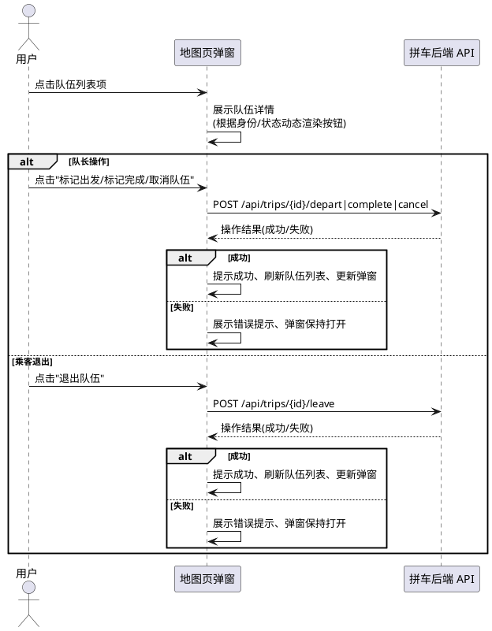

### **5.1.3 异常场景**
1. **未登录或会话失效**
a. 触发条件：用户会话令牌缺失或已过期时触发行程操作
b. 系统行为：后端返回 401 未授权，前端展示游客进入遮罩
c. 用户感知：弹窗关闭，页面显示游客登录入口
2. **非队长执行队长操作**
a. 触发条件：非队长用户通过非常规手段触发队长操作接口
b. 系统行为：后端返回"仅队长可执行该操作"错误
c. 用户感知：弹窗内展示"仅队长可执行该操作"提示
3. **非法状态流转**
a. 触发条件：对"已完成"队伍执行标记出发，或对"待出发"队伍执行标记完成
b. 系统行为：后端返回"非法状态流转"错误
c. 用户感知：弹窗内展示"非法状态流转：XX 不可变为 XX"提示
4. **退出未加入的队伍**
a. 触发条件：用户对未加入的队伍触发退出操作
b. 系统行为：后端返回"您未加入该队伍"错误
c. 用户感知：弹窗内展示"您未加入该队伍"提示
5. **网络请求失败**
a. 触发条件：行程操作请求因网络中断或服务异常未达后端
b. 系统行为：前端捕获异常，展示通用错误提示
c. 用户感知：弹窗内展示"响应解析失败"或网络异常提示，弹窗保持打开

## **5.2 遗留死代码清理**

### **5.2.1 业务规则**
1. **清理范围规则**：须清理的遗留文件为旧版界面三件套，均为未被首页入口链接但仍可通过静态路径访问的文件。
a. 验收条件：[执行清理] → [指定的三个旧版界面文件被删除]
2. **清理前置校验规则**：清理前须确认目标文件未被任何活跃页面（index.html、map.html、forum.html）引用，方可执行删除。
a. 验收条件：[活跃页面均未引用目标文件] → [执行删除操作]
b. 验收条件：[任一活跃页面引用了目标文件] → [中止删除并报告引用关系]
3. **清理后不可访问规则**：清理完成后，旧版界面文件不得再通过任何 URL 路径访问。
a. 验收条件：[清理后通过浏览器请求旧版文件路径] → [返回 404 未找到]
4. **禁止项**：禁止删除未被列入清理范围的文件，禁止删除 vendor 目录下的第三方库文件。
a. 验收条件：[清理操作] → [仅清理范围内的文件被删除，其他文件保持不变]

### **5.2.2 交互流程**
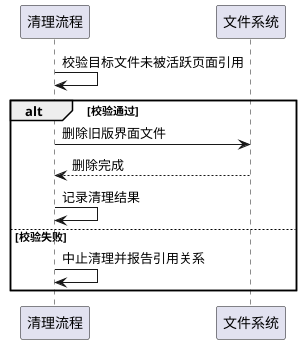

### **5.2.3 异常场景**
1. **发现活跃引用**
a. 触发条件：清理前校验发现某活跃页面仍引用目标文件
b. 系统行为：中止该文件删除，输出引用关系报告
c. 用户感知：收到"文件仍被引用，已中止清理"的提示及引用详情
2. **文件删除失败**
a. 触发条件：目标文件被占用或无删除权限
b. 系统行为：捕获异常，跳过该文件并继续处理其余文件
c. 用户感知：收到"部分文件删除失败"的提示及失败文件清单

## **5.3 底图图层切换**

### **5.3.1 业务规则**
1. **默认底图规则**：地图页加载时须默认显示 OSM 街道图层，保持现有地图外观不变。
a. 验收条件：[地图页首次加载] → [底图为 OSM 街道图层]
2. **图层切换控件规则**：地图页须提供图层切换控件，允许用户在"OSM 街道"与"ESRI 卫星"两种底图间手动切换。
a. 验收条件：[地图页加载完成] → [地图上显示图层切换控件，含"OSM 街道"与"ESRI 卫星"两个选项]
b. 验收条件：[用户选择"ESRI 卫星"] → [底图切换为 ESRI 卫星影像图层]
c. 验收条件：[用户选择"OSM 街道"] → [底图切换回 OSM 街道图层]
3. **切换后叠加层保留规则**：底图切换时，校区标记、POI 标记、校区边界多边形、队伍范围圆等叠加层须保持不变，不得因切换底图而丢失或错位。
a. 验收条件：[用户切换底图] → [所有校区标记、POI 标记、边界多边形、范围圆均保留且位置正确]
4. **滨海校区辨识规则**：用户切换至 ESRI 卫星图层后，应能观察到滨海校区的真实地表影像，而非 OSM 上的水域显示。
a. 验收条件：[用户在卫星图层下查看滨海校区区域] → [可见真实地表影像而非水域色块]
5. **禁止项**：禁止将 ESRI 卫星设为默认底图，禁止移除现有 OSM 街道图层。
a. 验收条件：[地图页加载] → [默认底图为 OSM 街道，ESRI 卫星仅作为可选切换项]

### **5.3.2 交互流程**
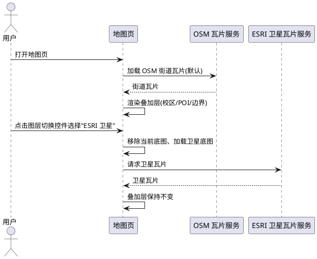

### **5.3.3 异常场景**
1. **卫星瓦片加载失败**
a. 触发条件：ESRI 卫星瓦片服务不可达或返回错误瓦片
b. 系统行为：地图显示瓦片加载异常区域，图层切换控件保持可用
c. 用户感知：卫星区域出现空白或加载失败标记，可手动切回 OSM 街道图层
2. **图层切换控件初始化失败**
a. 触发条件：Leaflet 控件初始化异常
b. 系统行为：捕获异常，地图以默认 OSM 底图正常工作，仅切换功能不可用
c. 用户感知：地图正常显示街道底图，但无图层切换控件

# **6. 数据约束**

## **6.1 队伍对象**
1. **tripId**：队伍唯一标识，非空字符串，格式为 `t_` 前缀加随机串。
2. **leaderName**：队长用户名，非空字符串，用于判断当前用户是否为队长。
3. **status**：队伍当前状态，取值范围为 {待出发, 已满员, 已出发, 已完成, 已取消}。
4. **currentSeats**：当前已占用座位数，非负整数，须不大于 maxSeats。
5. **maxSeats**：最大可拼人数，正整数。
6. **origin**：出发地名称，非空字符串。
7. **destination**：目的地名称，非空字符串。
8. **departAt**：出发时间，ISO 格式字符串，须晚于创建时当前时间。
9. **fee**：费用，可为 null 表示免费，非 null 时须为非负数值。
10. **gender**：性别要求，取值范围为 {不限, 仅女生, 仅男生}。
11. **remark**：备注，可为 null，非 null 时长度不超过 200 字。

## **6.2 当前用户会话**
1. **username**：当前登录用户昵称，非空字符串，用于与队伍 leaderName 比对判断队长身份。
2. **gender**：当前用户性别，取值范围为 {男, 女, 保密}。
3. **token**：会话令牌，非空字符串，用于 API 鉴权，缺失或失效时触发游客进入流程。

## **6.3 底图图层配置**
1. **默认图层**：OSM 街道图层，瓦片来源为 OpenStreetMap 标准瓦片服务。
2. **备选图层**：ESRI 卫星图层，瓦片来源为 ArcGIS Online World_Imagery 服务。
3. **当前选中图层**：取值范围为 {osm, satellite}，初始值为 osm。
---

<!-- ==================== Phase 2 分隔标记 ==================== -->

# **7. 高德地图迁移 Phase 2：原生 POI 地点选择与拼车业务接入**

> **本章节为高德地图迁移方案的需求规格，追加于既有行程生命周期/死代码清理/底图图层切换需求之后。**
>
> **实现页面**：`/map_amap.html`（`static/map_amap.js`），不替换现有 `/map.html`。
>
> **分阶段交付**：Phase 2A（高德原生地点选择）→ Phase 2B（创建队伍接入）→ Phase 2C（加入队伍接入）。
>
> **EARS 格式说明**：每条需求采用 EARS 句式标注，`[EARS: When]` 表示事件驱动，`[EARS: While]` 表示状态驱动，`[EARS: If]` 表示异常响应，`[EARS: Ubiquitous]` 表示无条件要求。每条同时标注 `[FR]`（功能需求）或 `[CONSTRAINT]`（约束）。

## **7.1 组件定位（Phase 2 增量）**

### **7.1.1 核心职责**
本组件负责在高德地图底图上实现基于原生 POI 的地点选择交互，用户点击地图即可获取真实高德地点信息并进入拼车业务入口，实现"选中真实地点→创建或加入队伍"的完整闭环。

### **7.1.2 核心输入**
1. 用户在高德地图上的点击操作（`map.on("click", event)`，携带 `event.lnglat` 坐标）。
2. 高德 PlaceSearch 服务返回的附近真实 POI 数据（id、name、location、address、type）。
3. 用户在地点操作卡片上触发的指令：我要创建队伍 / 加入其他队伍 / 取消。
4. 当前登录用户的会话身份（用户名、性别、令牌），复用现有游客进入机制。

### **7.1.3 核心输出**
1. 点击地图后展示的地点操作卡片（含地点名称、地址、类型、操作按钮）。
2. 地图上临时渲染的当前选中地点 Marker（高亮样式，仅一个）。
3. 创建队伍时提交给后端 API 的目的地数据（destination_name / destination_lng / destination_lat 等）。
4. 加入队伍时基于选中 POI 的 name/location 查询返回的附近队伍列表。

### **7.1.4 职责边界**
1. 本组件不负责新增或修改任何后端 API，所有创建/加入/搜索/退出接口已就绪，仅做前端对接。
2. 本组件不负责数据库 schema 重建，不因迁移高德地图而新增数据库字段或重建表结构。
3. 本组件不负责论坛、评论、点赞等其他模块的任何改动。
4. 本组件不负责替换现有 `/map.html`（Leaflet 版），Phase 2 全部验收通过后才修改首页入口。
5. 本组件不负责批量绘制 `osm_pois.json` 中的全部 POI 为自定义 Marker，高德正式页面不主动绘制其中全部 POI。
6. 本组件不负责人为生成地点名称和坐标，所有地点信息须来自高德 PlaceSearch 真实返回。

## **7.2 领域术语（Phase 2 增量）**

**高德原生 POI**
: 由高德地图底图或 AMap.PlaceSearch 服务直接返回的真实地点信息，包含 POI ID、名称、坐标、地址、类型等字段，区别于 OSM 自定义 Marker。

**地点操作卡片**
: 用户点击地图并成功识别到高德 POI 后弹出的交互面板，展示地点名称、地址、类型，并提供"我要创建队伍"与"加入其他队伍"两个操作入口。

**选中地点 Marker**
: 用户成功选择一个高德 POI 后在地图上临时渲染的高亮标记，用于告知用户"你当前选择的是这里"，同一时刻仅存在一个。

**findNearestAmapPoi**
: 封装的高德 POI 近点搜索函数，入参为经纬度坐标，出参为距离最近且名称有效的高德 POI 对象或 null。

**数据来源优先级**
: 高德正式页面中地点数据的选取优先顺序：高德原生 POI / PlaceSearch > 已确认的校区数据 > 无真实地点则不显示。

## **7.3 角色与边界（Phase 2 增量）**

### **7.3.1 核心角色**
- 游客：已通过游客进入机制登录的任意用户，可在高德地图上点击地点、查看地点操作卡片、创建队伍、加入队伍。
- 队长：在高德地图上选中地点后创建队伍的用户，复用现有队长权限体系。
- 乘客：通过高德地图选中地点后加入队伍的用户，复用现有乘客权限体系。

### **7.3.2 外部系统**
- 高德地图 JS API（AMap.Map）：提供地图底图渲染、原生 POI 显示、点击事件监听。
- 高德 PlaceSearch 服务（AMap.PlaceSearch）：提供 `searchNearBy` 能力，返回点击点附近真实 POI 列表。
- 拼车后端 API：提供队伍创建（POST /api/trips）、队伍搜索（GET /api/trips）、加入/退出/状态流转接口，本组件全部复用，不新增不修改。

### **7.3.3 交互上下文**
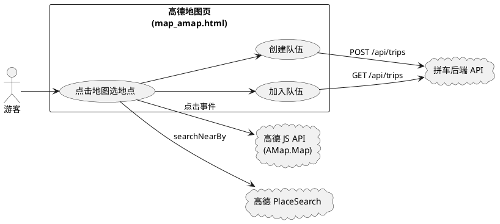

## **7.4 DFX约束（Phase 2 增量）**

### **7.4.1 性能**
1. 用户点击地图后至地点操作卡片展示的端到端响应时间不得超过 3 秒（含 PlaceSearch 网络往返）。
2. `findNearestAmapPoi` 函数的 PlaceSearch 搜索半径须在 100～300 米范围内，保证响应速度与结果精度平衡。
3. 选中地点 Marker 的渲染与移除须在 200 毫秒内完成，不得出现地图卡顿。

### **7.4.2 可靠性**
1. 高德 PlaceSearch 服务不可达或返回空结果时，须向用户明确提示"该位置附近未识别到明确地点"，不得伪造地点。
2. 地点操作卡片展示期间，用户切换选择地点时须正确移除旧 Marker 并渲染新 Marker，不得出现多个选中 Marker 并存。
3. 高德 JS API 加载失败时，须展示配置警告提示，不得进入白屏状态。

### **7.4.3 安全性**
1. 创建队伍与加入队伍操作须携带当前用户会话令牌进行鉴权，复用现有 api 封装的 Authorization 头注入机制。
2. 前端地点操作卡片的按钮显示仅为交互引导，最终操作权限以后端校验结果为准。

### **7.4.4 可维护性**
1. 前端函数命名须使用 camelCase（如 findNearestAmapPoi、showPoiActionCard、clearSelectedMarker）。
2. 新增交互逻辑须在浏览器控制台输出关键操作日志（点击坐标、PlaceSearch 结果、选中 POI 信息），便于排查。
3. `osm_pois.json` 文件须保留不得删除，但高德正式页面不主动加载和绘制其中全部 POI。

### **7.4.5 兼容性**
1. Phase 2 功能须在 `/map_amap.html` 页面独立实现，不得影响现有 `/map.html`（Leaflet 版）的任何行为。
2. 复用现有后端 API 时须保持请求参数与响应处理逻辑不变，不得因前端迁移而要求后端接口变更。
3. 首页"进入地图"入口在 Phase 2 全部人工验收通过前须保持指向 `/map.html`，不得提前切换。

## **7.5 核心能力**

### **7.5.1 [Phase 2A] 高德原生 POI 地点选择**

#### **7.5.1.1 业务规则**

**一、地图显示原则（对应需求第一章）**

1. **[FR] [EARS: Ubiquitous]** 系统须使用高德地图底图原生显示的地点名称和地点图标，包括但不限于学校、医院、商场、店铺、公园、公交站、餐厅、生活服务地点及其他高德原生 POI。
a. 验收条件：[高德地图页加载完成] → [底图上可见高德原生 POI 的名称与图标，无需前端额外绘制]

2. **[CONSTRAINT] [EARS: Ubiquitous]** 系统禁止将 `osm_pois.json` 中的全部地点绘制为自定义 Marker，禁止重复覆盖高德地图已存在的 POI 图标和文字。
a. 验收条件：[高德正式页面加载] → [地图上不出现 osm_pois.json 批量自定义 Marker]

3. **[FR] [EARS: Ubiquitous]** 系统须在地图上保留以下四类 Marker：校区中心 Marker、已确认的学校入口/校门 Marker、拼车队伍 Marker（如需要）、用户当前选择地点 Marker（临时）。
a. 验收条件：[高德地图页加载] → [校区中心与校门 Marker 正常显示，其余普通地点使用高德原生显示效果]

4. **[CONSTRAINT] [EARS: Ubiquitous]** 系统禁止在正式高德页面主动加载并绘制 `osm_pois.json` 中全部 POI，该文件保留但不作为正式页面主要地点展示方式。
a. 验收条件：[高德正式页面运行] → [不发起 osm_pois.json 全量加载与 Marker 绘制请求]

**二、用户选择地点交互（对应需求第二章）**

5. **[FR] [EARS: When]** 当用户点击高德地图上某区域时，系统须获取点击坐标 `event.lnglat`，并以该坐标为中心在附近小范围查询真实高德 POI。
a. 验收条件：[用户点击地图任意位置] → [系统获取 event.lnglat 并发起 PlaceSearch 近点查询]

6. **[FR] [EARS: When]** 当系统发起近点 POI 查询时，须使用 `AMap.PlaceSearch.searchNearBy()` 方法，搜索半径在 100～300 米范围内。
a. 验收条件：[点击坐标确定] → [调用 searchNearBy 并传入半径 100～300 米参数]

7. **[FR] [EARS: When]** 当 PlaceSearch 返回多个 POI 时，系统须选取距离点击点最近且名称有效的地点作为选中 POI。
a. 验收条件：[搜索返回 N 条 POI] → [选取距离最小且 name 非空的一条作为选中结果]

8. **[CONSTRAINT] [EARS: Ubiquitous]** 系统禁止人为生成地点名称和坐标，所有展示的地点信息须来自高德 PlaceSearch 真实返回的 POI ID、name、location、address、type 字段。
a. 验收条件：[地点操作卡片展示] → [卡片中所有字段值均来自高德 PlaceSearch 返回数据，无前端伪造]

9. **[FR] [EARS: When]** 当系统在点击点附近找到真实高德 POI 时，须弹出 Campus map 地点操作卡片，展示地点名称、地址、地点类型，并提供"我要创建队伍"与"加入其他队伍"两个操作按钮。
a. 验收条件：[findNearestAmapPoi 返回非 null] → [弹出地点操作卡片，含名称/地址/类型/两个操作按钮]

10. **[FR] [EARS: If]** 若系统在点击点附近未找到明确高德 POI，则系统须显示"该位置附近未识别到明确地点"提示，并允许用户取消，禁止伪造地点。
a. 验收条件：[findNearestAmapPoi 返回 null] → [显示"该位置附近未识别到明确地点"提示，不弹出操作卡片]

11. **[FR] [EARS: When]** 当用户点击取消或关闭提示时，系统须清除当前选中状态，不保留任何临时 Marker。
a. 验收条件：[用户在"未识别到地点"提示中点击取消] → [选中状态清空，地图无临时 Marker]

**三、地点选择状态管理（对应需求第五章）**

12. **[FR] [EARS: When]** 当用户成功选择一个高德 POI 后，系统须允许临时添加一个选中 Marker，用于告知用户"你当前选择的是这里"。
a. 验收条件：[用户点击地图并成功识别 POI] → [地图上出现一个选中 Marker 标记该 POI 位置]

13. **[FR] [EARS: Ubiquitous]** 选中地点 Marker 须使用 Campus map 自定义高亮样式，与高德原生 POI 图标视觉区分。
a. 验收条件：[选中 Marker 渲染] → [Marker 使用自定义高亮样式，可辨识为"当前选中"标记]

14. **[CONSTRAINT] [EARS: While]** 在任意时刻，系统须仅显示一个当前选中地点 Marker，禁止同时显示多个选中 Marker。
a. 验收条件：[用户连续点击多个地点] → [地图上始终仅存在最新一个选中 Marker]

15. **[FR] [EARS: When]** 当用户选择另一个地点时，系统须移除旧选中 Marker，仅保留最新一个。
a. 验收条件：[已存在选中 Marker 时用户点击新地点] → [旧 Marker 被移除，新 Marker 渲染于最新选中位置]

16. **[CONSTRAINT] [EARS: Ubiquitous]** 系统禁止重新绘制地图上所有 POI 作为选中 Marker，选中 Marker 仅对应当前用户选择的单一地点。
a. 验收条件：[用户选择地点] → [仅渲染 1 个选中 Marker，不触发全量 POI 绘制]

**四、高德原生地点优先（对应需求第六章）**

17. **[FR] [EARS: Ubiquitous]** 系统须按以下数据来源优先级确定地点信息：第一优先级为高德原生 POI / PlaceSearch，第二优先级为已确认的校区数据，第三级为无真实地点则不显示。
a. 验收条件：[用户点击地图] → [优先使用高德 PlaceSearch 结果；无结果时回退校区数据；均无则不显示地点]

18. **[CONSTRAINT] [EARS: Ubiquitous]** 系统不再使用"OSM POI → 批量 Marker"作为正式高德地图页面的主要地点展示方式。
a. 验收条件：[高德正式页面] → [地点展示依赖高德原生底图与 PlaceSearch，不依赖 OSM POI 批量 Marker]

**五、点击地点实现建议（对应需求第七章）**

19. **[FR] [EARS: When]** 当高德地图实例初始化完成后，系统须在 `AMap.Map` 上监听 `click` 事件，事件回调中获取 `event.lnglat` 并调用 `findNearestAmapPoi(lnglat)` 搜索最近真实 POI。
a. 验收条件：[地图加载完成] → [map.on("click") 已绑定，点击触发 findNearestAmapPoi 调用]

20. **[FR] [EARS: Ubiquitous]** 系统须封装 `findNearestAmapPoi(lnglat)` 函数，返回对象结构为 `{id, name, lng, lat, address, type}`，无搜索结果时返回 `null`。
a. 验收条件：[findNearestAmapPoi 有结果] → [返回包含 id/name/lng/lat/address/type 的对象]
b. 验收条件：[findNearestAmapPoi 无结果] → [返回 null]

21. **[FR] [EARS: When]** 当 `findNearestAmapPoi` 返回非 null 结果时，系统须展示 Campus map 地点操作面板（地点操作卡片）。
a. 验收条件：[findNearestAmapPoi 返回有效 POI] → [地点操作面板展示，含地点信息与操作按钮]

**六、不破坏现有业务（对应需求第八章）**

22. **[CONSTRAINT] [EARS: Ubiquitous]** 系统须继续复用当前游客身份、当前性别、创建队伍 API、加入队伍 API、队伍列表、SQLite、论坛、点赞、评论等现有业务能力，不得因地图迁移而破坏。
a. 验收条件：[Phase 2 功能上线] → [游客进入/性别/队伍 CRUD/论坛/点赞/评论均正常工作]

23. **[FR] [EARS: Ubiquitous]** 地图层须仅负责"用户选中了哪个真实地点"，业务层须仅负责"在这个地点创建/加入什么拼车队伍"，两层职责分离。
a. 验收条件：[地点选择与队伍操作] → [地图层仅产出选中 POI 信息，业务层仅消费该信息调用后端 API]

**七、正式页面迁移方式（对应需求第九章）**

24. **[FR] [EARS: Ubiquitous]** 系统须在 `/map_amap.html` 页面实现 Phase 2 全部功能，不得立即替换 `/map.html`。
a. 验收条件：[Phase 2 开发] → [功能在 map_amap.html/map_amap.js 中实现，map.html/map.js 不受影响]

25. **[CONSTRAINT] [EARS: While]** 在 Phase 2A/2B/2C 全部人工验收通过之前，首页"进入地图"入口须保持指向 `/map.html`，禁止提前切换至 `/map_amap.html`。
a. 验收条件：[Phase 2 验收未全部通过] → [首页入口指向 /map.html]

26. **[FR] [EARS: When]** 当 Phase 2A（高德原生地点选择）、Phase 2B（创建队伍接入）、Phase 2C（加入队伍接入）全部人工验收通过后，系统须将首页"进入地图"入口改为指向 `/map_amap.html`。
a. 验收条件：[三个 Phase 全部验收通过] → [首页入口切换至 /map_amap.html]

#### **7.5.1.2 交互流程**
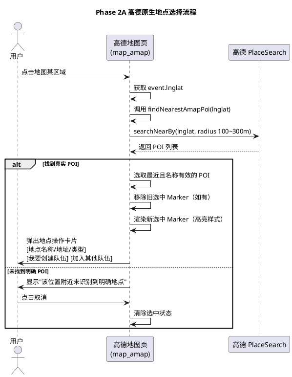

#### **7.5.1.3 异常场景**
1. **高德 PlaceSearch 服务不可达**
a. 触发条件：网络中断或高德服务异常导致 searchNearBy 无响应
b. 系统行为：捕获异常，findNearestAmapPoi 返回 null
c. 用户感知：显示"该位置附近未识别到明确地点"提示，可重新点击或取消

2. **PlaceSearch 返回空结果**
a. 触发条件：点击点附近 100～300 米范围内无高德 POI
b. 系统行为：findNearestAmapPoi 返回 null，不伪造地点
c. 用户感知：显示"该位置附近未识别到明确地点"提示，允许取消

3. **PlaceSearch 返回结果但名称均为空**
a. 触发条件：返回的 POI 列表中所有条目 name 字段为空或无效
b. 系统行为：过滤无效名称 POI 后无剩余，findNearestAmapPoi 返回 null
c. 用户感知：显示"该位置附近未识别到明确地点"提示

4. **高德 JS API 加载失败**
a. 触发条件：网络问题或 Key 配置错误导致 AMap JS API 无法加载
b. 系统行为：显示配置警告提示，不进入地图交互
c. 用户感知：页面显示"高德 JS API 加载失败"警告及配置指引

5. **用户快速连续点击多个地点**
a. 触发条件：用户在短时间内连续点击地图不同位置
b. 系统行为：每次点击触发新的 findNearestAmapPoi，后发结果覆盖先发选中 Marker
c. 用户感知：地图上始终仅保留最新一个选中 Marker，不出现多个并存

6. **会话失效**
a. 触发条件：用户会话令牌缺失或已过期时点击地点操作
b. 系统行为：复用现有 api 封装的 401 检测逻辑，触发游客进入遮罩
c. 用户感知：地点操作卡片关闭，页面显示游客登录入口

### **7.5.2 [Phase 2B] 创建队伍接入（概要）**

> **本节为概要，不展开详细 EARS 需求，待 Phase 2A 验收通过后细化。**

#### **7.5.2.1 业务规则（概要）**
1. **[FR] [EARS: When]** 当用户在地点操作卡片中点击"我要创建队伍"时，系统须继续调用当前已有创建队伍逻辑和后端 API（POST /api/trips），不重新开发后端。
a. 验收条件：[点击"我要创建队伍"] → [复用现有创建队伍 API，不新增后端接口]

2. **[FR] [EARS: Ubiquitous]** 创建表单须继续支持：出发地点、目的地、出发时间、人数限制、性别要求、备注。
a. 验收条件：[创建队伍表单展示] → [含出发地点/目的地/出发时间/人数/性别/备注全部字段]

3. **[FR] [EARS: When]** 当用户提交创建队伍时，目的地数据须改为使用刚才选中的高德 POI 信息（destination_name、destination_poi_id、destination_lng、destination_lat、destination_address）。
a. 验收条件：[创建队伍提交] → [destination 相关字段使用选中高德 POI 数据]

4. **[CONSTRAINT] [EARS: Ubiquitous]** 系统禁止因迁移高德地图而重建数据库。若现有数据库暂时没有 destination_poi_id / destination_address 等字段，Demo 第一版至少保存目的地名称、经度、纬度。
a. 验收条件：[创建队伍成功] → [至少保存 destination 名称与经纬度，不重建数据库]

### **7.5.3 [Phase 2C] 加入队伍接入（概要）**

> **本节为概要，不展开详细 EARS 需求，待 Phase 2B 验收通过后细化。**

#### **7.5.3.1 业务规则（概要）**
1. **[FR] [EARS: When]** 当用户在地点操作卡片中点击"加入其他队伍"时，系统须继续复用当前已有的搜索附近队伍、性别验证、人数验证、加入、退出逻辑。
a. 验收条件：[点击"加入其他队伍"] → [复用现有搜索/验证/加入/退出逻辑，不重写]

2. **[FR] [EARS: When]** 当系统查询相关队伍时，须按当前选中高德 POI 的 name / location 进行查询。
a. 验收条件：[加入队伍查询] → [以选中 POI 的 name/location 作为查询条件]

3. **[CONSTRAINT] [EARS: Ubiquitous]** 系统禁止重写 trips API，加入队伍须完全复用现有 GET /api/trips 与 POST /api/trips/{id}/join 接口。
a. 验收条件：[加入队伍功能] → [仅调用现有 trips API，无新增后端接口]

## **7.6 数据约束（Phase 2 增量）**

### **7.6.1 高德 POI 对象**
1. **id**：高德 POI 唯一标识，字符串，由高德 PlaceSearch 返回，前端不得伪造。
2. **name**：地点名称，非空字符串，由高德 PlaceSearch 返回，用于地点操作卡片展示与队伍查询。
3. **lng**：经度，数值（GCJ-02 坐标系），由高德 PlaceSearch 返回的 location.lng。
4. **lat**：纬度，数值（GCJ-02 坐标系），由高德 PlaceSearch 返回的 location.lat。
5. **address**：地址，字符串，可为空，由高德 PlaceSearch 返回。
6. **type**：地点类型，字符串，由高德 PlaceSearch 返回，用于地点操作卡片展示。

### **7.6.2 选中地点状态**
1. **selectedPoi**：当前选中高德 POI 对象，取值为 7.6.1 定义的对象或 null，初始值为 null。
2. **selectedMarker**：当前选中地点 Marker 实例，取值为高德 Marker 对象或 null，同一时刻最多存在一个。
3. **searchRadius**：PlaceSearch 近点搜索半径，取值范围为 [100, 300] 米。

### **7.6.3 创建队伍目的地数据（Phase 2B）**
1. **destination_name**：目的地名称，取自选中高德 POI 的 name 字段。
2. **destination_poi_id**：目的地高德 POI ID，取自选中高德 POI 的 id 字段，Demo 第一版可为空。
3. **destination_lng**：目的地经度，取自选中高德 POI 的 lng 字段。
4. **destination_lat**：目的地纬度，取自选中高德 POI 的 lat 字段。
5. **destination_address**：目的地地址，取自选中高德 POI 的 address 字段，Demo 第一版可为空。

## **7.7 不修改范围（约束清单）**

> 以下为本次高德地图迁移明确不修改的范围，作为约束强制执行。

1. **[CONSTRAINT]** 不修改后端 API：`app/api/trips.py`、`app/services/trip_service.py` 不做任何改动，创建/加入/搜索/退出/状态流转接口全部复用。
2. **[CONSTRAINT]** 不重建数据库：SQLite schema 不变，不新增表、不新增字段、不重建结构。Demo 第一版创建队伍至少保存目的地名称与经纬度即可。
3. **[CONSTRAINT]** 不修改现有 Leaflet 版地图页：`static/map.html`、`static/map.js` 不做任何改动，Phase 2 全部验收通过前首页入口保持指向 `/map.html`。
4. **[CONSTRAINT]** 不修改论坛模块：论坛、帖子、评论、点赞相关代码与页面不做任何改动。
5. **[CONSTRAINT]** 不修改游客进入机制：游客身份、性别选择、会话令牌逻辑复用现有实现，不做改动。
6. **[CONSTRAINT]** 不删除 `osm_pois.json`：该文件保留，但高德正式页面不主动加载和绘制其中全部 POI。
7. **[CONSTRAINT]** 不人为生成地点数据：所有展示的地点名称、坐标、地址、类型须来自高德 PlaceSearch 真实返回，禁止前端伪造。
8. **[CONSTRAINT]** 不批量绘制自定义 POI Marker：高德正式页面不再将 `osm_pois.json` 全部地点绘制为自定义 Marker，普通地点使用高德原生显示效果。
---

<!-- ==================== Phase 2A 改进 + Phase 2B + Phase 2C 分隔标记 ==================== -->

# **8. Phase 2A 改进 + Phase 2B + Phase 2C：逐级搜索 + 两步确认 + 创建/加入队伍**

> **本章节为高德地图迁移 Phase 2 的增量改进与详细展开需求，追加于既有 Phase 2A（7.5.1 节）之后。**
>
> **本章节覆盖以下三类变更：**
> - **Phase 2A 改进**：将现有固定半径单次搜索改为逐级扩大策略，增加多类型 POI 覆盖，改进最近 POI 选择算法，增强异常处理与友好提示。
> - **Phase 2B 详细展开**：新增两步地点确认卡片（先确认地点再选择操作），详细展开创建队伍接入的完整业务规则与交互流程。
> - **Phase 2C 详细展开**：详细展开加入队伍接入的完整业务规则与交互流程。
>
> **实现页面**：`/map_amap.html`（`static/map_amap.js` + `static/map_amap.css`），不替换现有 `/map.html`。
>
> **改动范围**：优先仅修改 `static/map_amap.js`、`static/map_amap.css`，必要时 `static/map_amap.html`。
>
> **EARS 格式说明**：每条需求沿用第 7 章标注方式。额外标注 `[改进]` 表示改进现有 Phase 2A 需求，`[新增]` 表示全新需求条目。

## **8.1 组件定位（增量改进）**

### **8.1.1 核心职责**
本组件负责改进高德地图点击→POI 识别的搜索策略与选择算法，新增两步地点确认交互，并完整接入创建队伍与加入队伍业务，实现"点击地图→逐级搜索真实 POI→确认地点→创建或加入队伍"的端到端闭环。

### **8.1.2 核心输入**
1. 用户在高德地图上的点击操作（`map.on("click", event)`，携带 `event.lnglat` 坐标）。
2. 高德 PlaceSearch 服务在逐级扩大半径（100m→300m→500m）下返回的附近真实 POI 数据。
3. 用户在地点确认卡片上触发的指令：确认选择 / 重新选择。
4. 用户在地点操作卡片上触发的指令：我要创建队伍 / 加入其他队伍。
5. 用户在创建队伍表单中提交的队伍信息（出发地点、出发时间、人数限制、性别要求、备注）。
6. 当前登录用户的会话身份（用户名、性别、令牌），复用现有游客进入机制。

### **8.1.3 核心输出**
1. 点击地图后展示的地点确认卡片（含地点名称、地址、类型、距离、数据来源）。
2. 确认地点后展示的地点操作卡片（含"我要创建队伍"与"加入其他队伍"按钮）。
3. 创建队伍时提交给后端 POST /api/trips 的队伍数据（含 destination、destinationLat、destinationLng 等）。
4. 加入队伍时基于选中 POI 名称查询返回的附近队伍列表。
5. 地图上临时渲染的当前选中地点 Marker（高亮样式，仅一个）。

### **8.1.4 职责边界**
1. 本组件不负责新增或修改任何后端 API，所有创建/加入/搜索/退出/状态流转接口全部复用现有实现。
2. 本组件不负责重建数据库 schema，不新增数据库字段或表结构。
3. 本组件不负责论坛、评论、点赞等其他模块的任何改动。
4. 本组件不负责修改现有 Leaflet 版地图页（`static/map.html`、`static/map.js`）。
5. 本组件不负责批量重新绘制高德已有 POI Marker，高德底图继续负责原生地点显示。
6. 本组件不负责人为生成地点名称和坐标，所有地点信息须来自高德 PlaceSearch 真实返回。

## **8.2 领域术语（增量）**

**逐级扩大搜索策略**
: 以点击位置为圆心，按 100 米→300 米→500 米的顺序依次发起 PlaceSearch 周边搜索，前一级无有效结果时才扩大到下一级，避免一开始使用过大范围导致结果不精确。

**多类型 POI 覆盖搜索**
: 当空关键词搜索结果不可靠时，按高德支持的 POI 类型分类进行附近查询，覆盖至少十种类型（餐饮服务、购物服务、科教文化服务、医疗保健服务、生活服务、体育休闲服务、住宿服务、交通设施服务、风景名胜、公司企业），确保用户点击高德底图已显示的明显地点时能识别到对应真实 POI。

**地点确认卡片**
: 用户点击地图并成功识别到高德 POI 后弹出的第一步交互面板，展示地点名称、地址、类型、距离点击位置、数据来源，提供"确认选择"与"重新选择"两个按钮，用于防止用户点偏后误选附近其他地点。

**地点操作卡片**
: 用户在地点确认卡片中点击"确认选择"后弹出的第二步交互面板，提供"我要创建队伍"与"加入其他队伍"两个操作入口。

**两步确认流程**
: 用户点击地图找到 POI 后，先显示地点确认卡片（第一步），确认地点后再显示地点操作卡片（第二步），避免直接进入创建/加入队伍操作。

**POI 有效性校验**
: 判断 PlaceSearch 返回的 POI 是否有效的标准，要求 poi.location 存在、name 非空、poi.id 存在、经纬度有效（数值类型）。

## **8.3 角色与边界（增量）**

### **8.3.1 核心角色**
- 游客：已通过游客进入机制登录的任意用户，可在高德地图上点击地点、确认地点、创建队伍、加入队伍。
- 队长：在高德地图上选中并确认地点后创建队伍的用户，复用现有队长权限体系。
- 乘客：通过高德地图选中并确认地点后加入队伍的用户，复用现有乘客权限体系。

### **8.3.2 外部系统**
- 高德地图 JS API（AMap.Map）：提供地图底图渲染、原生 POI 显示、点击事件监听。
- 高德 PlaceSearch 服务（AMap.PlaceSearch）：提供 `searchNearBy` 能力，支持逐级扩大半径与多类型查询。
- 拼车后端 API：提供队伍创建（POST /api/trips）、队伍搜索（GET /api/trips?destination=）、加入/退出/状态流转接口，本组件全部复用，不新增不修改。

### **8.3.3 交互上下文**
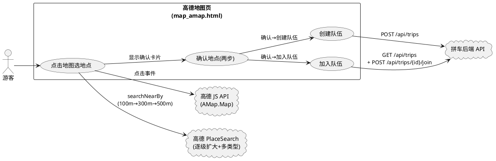

## **8.4 DFX约束（增量改进）**

### **8.4.1 性能**
1. 用户点击地图后至地点确认卡片展示的端到端响应时间不得超过 5 秒（含逐级扩大搜索最多三轮 PlaceSearch 网络往返）。
2. 单次 PlaceSearch 搜索（任一 radius 级别）响应时间不得超过 2 秒。
3. 选中地点 Marker 的渲染与移除须在 200 毫秒内完成，不得出现地图卡顿。
4. 创建队伍表单提交后端响应时间不得超过 3 秒（含网络往返与列表刷新）。

### **8.4.2 可靠性**
1. 高德 PlaceSearch 服务不可达或返回空结果时，须向用户明确提示"附近暂未识别到明确地点，请点击更靠近地点名称或图标的位置。"，不得伪造地点，不得报错或白屏。
2. 以下异常情况均禁止导致报错或白屏：`p.location == null`、POI id 不存在、地址为空、PlaceSearch 返回 0 条、网络搜索失败。
3. 地点确认卡片展示期间，用户切换选择地点时须正确移除旧 Marker 并渲染新 Marker，不得出现多个选中 Marker 并存。
4. 创建队伍或加入队伍操作失败时，须在对应弹窗内展示错误提示，不得使页面进入不一致状态。

### **8.4.3 安全性**
1. 创建队伍与加入队伍操作须携带当前用户会话令牌进行鉴权，复用现有 api 封装的 Authorization 头注入机制。
2. 前端地点确认卡片与操作卡片的按钮显示仅为交互引导，最终操作权限以后端校验结果为准。

### **8.4.4 可维护性**
1. 前端函数命名须使用 camelCase（如 findNearestAmapPoiWithFallback、showPoiConfirmCard、showPoiActionCard、openCreateTripModal、openJoinTripModal）。
2. 新增交互逻辑须在浏览器控制台输出关键操作日志（点击坐标、逐级搜索过程、选中 POI 信息、创建/加入队伍结果），便于排查。
3. 逐级扩大搜索的半径序列与 POI 类型列表须以常量数组形式定义于 map_amap.js 顶部，便于维护调整。

### **8.4.5 兼容性**
1. Phase 2A 改进 + Phase 2B + Phase 2C 功能须在 `/map_amap.html` 页面独立实现，不得影响现有 `/map.html`（Leaflet 版）的任何行为。
2. 复用现有后端 API 时须保持请求参数与响应处理逻辑不变，不得因前端迁移而要求后端接口变更。
3. 首页"进入地图"入口在 Phase 2 全部人工验收通过前须保持指向 `/map.html`，不得提前切换。

## **8.5 核心能力**

### **8.5.1 [Phase 2A 改进] 逐级扩大搜索策略**

> **改进说明**：将现有 Phase 2A 中固定半径 200m 单次搜索改为 100m→300m→500m 逐级扩大策略，对应需求第二章。

#### **8.5.1.1 业务规则**

1. **[改进] [FR] [EARS: When]** 当用户点击高德地图获取 `event.lnglat` 后，系统须以该坐标为圆心，按 100 米→300 米→500 米的顺序依次发起 PlaceSearch 周边搜索。
a. 验收条件：[用户点击地图任意位置] → [系统首先以 100m 半径发起 searchNearBy 搜索]
b. 验收条件：[100m 搜索返回有效 POI] → [系统不再扩大半径，直接使用 100m 搜索结果]
c. 验收条件：[100m 搜索无有效结果且 300m 搜索返回有效 POI] → [系统使用 300m 搜索结果]
d. 验收条件：[100m 和 300m 均无有效结果且 500m 搜索返回有效 POI] → [系统使用 500m 搜索结果]
e. 验收条件：[100m、300m、500m 三级搜索均无有效结果] → [系统显示"附近暂未识别到明确地点"提示]

2. **[改进] [CONSTRAINT] [EARS: Ubiquitous]** 系统禁止一开始使用过大的搜索范围，第一级搜索半径必须为 100 米，不得直接使用 300m 或 500m 作为初始半径。
a. 验收条件：[用户点击地图] → [首次搜索半径为 100m，不是 200m/300m/500m]

3. **[改进] [CONSTRAINT] [EARS: Ubiquitous]** 系统搜索半径序列须为 [100, 300, 500]（单位：米），不得使用其他数值或更多级别，避免搜索次数过多影响响应速度。
a. 验收条件：[逐级搜索执行] → [半径序列为 [100, 300, 500]，最多发起 3 次 searchNearBy 调用]

4. **[改进] [FR] [EARS: When]** 当某一级搜索返回有效 POI 时，系统须立即停止后续更高级别搜索，使用当前级别结果进行最近 POI 选择。
a. 验收条件：[100m 搜索返回有效 POI] → [不发起 300m 和 500m 搜索]
b. 验收条件：[100m 无结果但 300m 返回有效 POI] → [不发起 500m 搜索]

#### **8.5.1.2 交互流程**
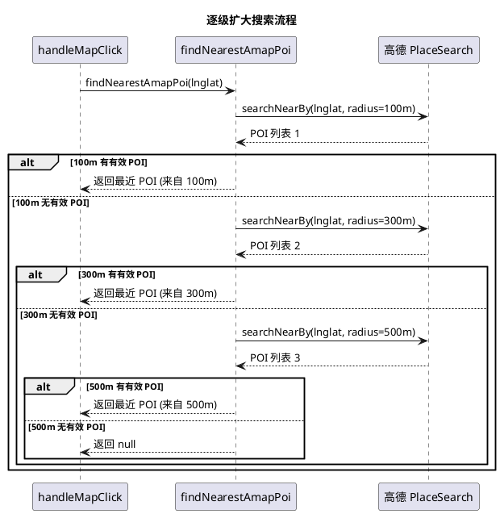

#### **8.5.1.3 异常场景**
1. **某一级搜索网络失败**
a. 触发条件：某一级 searchNearBy 因网络中断或服务异常无响应
b. 系统行为：捕获异常，继续尝试下一级搜索（如 100m 失败则尝试 300m），所有级别均失败时返回 null
c. 用户感知：若最终无结果则显示"附近暂未识别到明确地点"提示，不出现技术报错

2. **所有级别搜索均超时**
a. 触发条件：三级搜索均因网络问题超时
b. 系统行为：findNearestAmapPoi 返回 null
c. 用户感知：显示"附近暂未识别到明确地点，请点击更靠近地点名称或图标的位置。"提示

### **8.5.2 [Phase 2A 改进] 多类型 POI 覆盖搜索**

> **改进说明**：将现有空关键词单次搜索改为"优先空关键词，不可靠时按高德 POI 类型分类查询"策略，对应需求第三章。

#### **8.5.2.1 业务规则**

1. **[改进] [FR] [EARS: When]** 当系统在某一搜索半径级别发起搜索时，须优先尝试空关键词/通用附近 POI 查询。
a. 验收条件：[任一搜索半径级别发起搜索] → [首先以空关键词调用 searchNearBy]

2. **[改进] [FR] [EARS: When]** 当空关键词搜索结果不可靠（返回 0 条或返回的 POI 名称均为空）时，系统须按高德支持的 POI 类型进行附近查询，覆盖至少以下十种类型：餐饮服务、购物服务、科教文化服务、医疗保健服务、生活服务、体育休闲服务、住宿服务、交通设施服务、风景名胜、公司企业。
a. 验收条件：[空关键词搜索返回 0 条或名称均空] → [系统按十种 POI 类型依次发起附近查询]
b. 验收条件：[某一类型查询返回有效 POI] → [系统使用该类型查询结果，不再查询剩余类型]

3. **[改进] [CONSTRAINT] [EARS: Ubiquitous]** 系统禁止只搜索某一个固定关键词，须确保覆盖用户可能点击的各类高德原生地点（图书馆、体育馆、餐厅、便利店、酒店、学校建筑、商店等）。
a. 验收条件：[搜索策略执行] → [不出现仅搜索单一固定关键词的情况]

4. **[改进] [FR] [EARS: Ubiquitous]** 系统须将多类型搜索的结果合并后，再进行最近 POI 选择算法处理。
a. 验收条件：[多个类型查询均返回有效 POI] → [所有有效结果合并后统一按距离排序选取最近一条]

5. **[改进] [CONSTRAINT] [EARS: Ubiquitous]** POI 类型列表须以常量数组形式定义，便于后续维护调整，不得在函数内部硬编码。
a. 验收条件：[代码审查] → [POI 类型列表定义在 map_amap.js 顶部常量区]

#### **8.5.2.2 异常场景**
1. **空关键词搜索与所有类型搜索均无结果**
a. 触发条件：某一搜索半径级别下，空关键词搜索和十种类型搜索均返回 0 条有效 POI
b. 系统行为：该级别判定为无有效结果，继续下一级搜索半径（如当前为 100m 则尝试 300m）
c. 用户感知：若所有级别和类型均无结果，显示"附近暂未识别到明确地点"提示

2. **某类型查询异常**
a. 触发条件：某一 POI 类型查询时 PlaceSearch 回调异常
b. 系统行为：捕获异常，跳过该类型继续查询下一类型
c. 用户感知：不影响其他类型搜索，最终无结果时显示提示

### **8.5.3 [Phase 2A 改进] 最近 POI 选择算法**

> **改进说明**：改进现有最近 POI 选择逻辑，增加距离阈值校验与更严格的有效性判断，对应需求第四章。

#### **8.5.3.1 业务规则**

1. **[改进] [FR] [EARS: When]** 当 PlaceSearch 返回多个 POI 时，系统须计算点击位置与每个 POI location 之间的距离，选择距离最近的 POI，不得直接取第一条。
a. 验收条件：[搜索返回 N 条 POI（N>1）] → [系统计算每条 POI 与点击位置的距离，选取距离最小的一条]
b. 验收条件：[搜索返回 1 条 POI] → [系统使用该条 POI 作为选中结果]

2. **[改进] [FR] [EARS: When]** 当系统选取最近 POI 后，须校验该 POI 距离是否超过当前搜索半径，若超过则视为无有效地点。
a. 验收条件：[最近 POI 距离 ≤ 当前搜索半径] → [该 POI 视为有效，作为选中结果]
b. 验收条件：[最近 POI 距离 > 当前搜索半径] → [该 POI 视为无效，当前级别判定为无结果，继续下一级搜索]

3. **[改进] [FR] [EARS: Ubiquitous]** 系统须对 PlaceSearch 返回的每条 POI 执行有效性校验，仅满足以下全部条件的 POI 方为有效：poi.location 存在、name 非空、poi.id 存在、经纬度有效（数值类型）。
a. 验收条件：[POI 满足 location 存在 && name 非空 && id 存在 && lng/lat 为数值] → [该 POI 视为有效候选]
b. 验收条件：[POI 的 location 为 null] → [该 POI 被过滤排除]
c. 验收条件：[POI 的 name 为空或仅空白] → [该 POI 被过滤排除]
d. 验收条件：[POI 的 id 不存在] → [该 POI 被过滤排除]
e. 验收条件：[POI 的 lng 或 lat 不是数值类型] → [该 POI 被过滤排除]

4. **[改进] [FR] [EARS: When]** 当 100m 搜索级别找到有效 POI 时，须优先选择距离点击位置最近的有效 POI。
a. 验收条件：[100m 搜索返回多条有效 POI] → [选取距离点击位置最近的一条]

5. **[改进] [CONSTRAINT] [EARS: Ubiquitous]** 系统禁止人为生成或补充 POI 的任何字段，所有字段须来自高德 PlaceSearch 真实返回。
a. 验收条件：[选中 POI 的 id/name/lng/lat/address/type] → [均来自高德 PlaceSearch 返回数据，无前端伪造]

#### **8.5.3.2 异常场景**
1. **所有 POI 的 location 均为 null**
a. 触发条件：PlaceSearch 返回的 POI 列表中所有条目 location 字段为 null
b. 系统行为：过滤后无有效候选，当前级别判定为无结果
c. 用户感知：继续下一级搜索或最终显示"附近暂未识别到明确地点"提示

2. **最近 POI 距离超过搜索半径**
a. 触发条件：选取的最近 POI 距离点击位置大于当前搜索半径
b. 系统行为：视为无有效地点，继续下一级搜索
c. 用户感知：若所有级别均无有效地点，显示提示

### **8.5.4 [Phase 2A 改进] 异常处理与友好提示**

> **改进说明**：增强异常处理覆盖范围，改进用户提示文案，对应需求第十章。

#### **8.5.4.1 业务规则**

1. **[改进] [CONSTRAINT] [EARS: Ubiquitous]** 以下情况系统禁止报错或白屏：`p.location == null`、POI id 不存在、地址为空、PlaceSearch 返回 0 条、网络搜索失败。
a. 验收条件：[PlaceSearch 返回的某条 POI 的 location 为 null] → [系统跳过该条不报错，不白屏]
b. 验收条件：[PlaceSearch 返回的某条 POI 的 id 不存在] → [系统跳过该条不报错，不白屏]
c. 验收条件：[PlaceSearch 返回的某条 POI 的 address 为空] → [系统正常处理，address 字段显示为空或"—"，不报错]
d. 验收条件：[PlaceSearch 返回 0 条结果] → [系统继续下一级搜索或显示提示，不报错不白屏]
e. 验收条件：[网络搜索失败] → [系统捕获异常继续下一级搜索或返回 null，不报错不白屏]

2. **[改进] [FR] [EARS: When]** 当系统在所有搜索级别和类型均未找到有效 POI 时，须显示提示文案："附近暂未识别到明确地点，请点击更靠近地点名称或图标的位置。"
a. 验收条件：[所有级别和类型搜索均无有效结果] → [显示"附近暂未识别到明确地点，请点击更靠近地点名称或图标的位置。"提示]

3. **[改进] [CONSTRAINT] [EARS: Ubiquitous]** 系统禁止向用户显示技术报错信息（如 JavaScript 异常堆栈、HTTP 状态码、网络错误详情等）。
a. 验收条件：[任何异常情况] → [用户看到的是友好提示文案，不是技术报错]

4. **[改进] [FR] [EARS: When]** 当用户在"未识别到地点"提示中点击取消或关闭时，系统须清除当前选中状态，不保留任何临时 Marker。
a. 验收条件：[用户点击取消] → [选中状态清空，地图无临时 Marker，提示浮层隐藏]

#### **8.5.4.2 异常场景**
1. **高德 JS API 加载失败**
a. 触发条件：网络问题或 Key 配置错误导致 AMap JS API 无法加载
b. 系统行为：显示配置警告提示，不进入地图交互
c. 用户感知：页面显示"高德 JS API 加载失败"警告及配置指引，不白屏

2. **用户快速连续点击多个地点**
a. 触发条件：用户在短时间内连续点击地图不同位置
b. 系统行为：搜索进行中时忽略后续点击（isSearching 防抖），搜索完成后接受新点击
c. 用户感知：地图上始终仅保留最新一个选中 Marker，不出现多个并存

3. **会话失效**
a. 触发条件：用户会话令牌缺失或已过期时点击地点操作或创建/加入队伍
b. 系统行为：复用现有 api 封装的 401 检测逻辑，触发游客进入遮罩
c. 用户感知：卡片/弹窗关闭，页面显示游客登录入口

### **8.5.5 [Phase 2B 新增] 地点确认卡片（两步确认）**

> **新增说明**：在找到 POI 后与进入创建/加入队伍操作之间新增一步"地点确认"交互，对应需求第五章。

#### **8.5.5.1 业务规则**

1. **[新增] [FR] [EARS: When]** 当系统通过逐级搜索找到有效高德 POI 后，须首先弹出地点确认卡片（第一步），不得直接弹出地点操作卡片或直接进入创建/加入队伍流程。
a. 验收条件：[findNearestAmapPoi 返回非 null] → [弹出地点确认卡片，不直接弹出地点操作卡片]

2. **[新增] [FR] [EARS: Ubiquitous]** 地点确认卡片须展示以下信息：地点名称、地址、类型、距离点击位置、数据来源（标注为"高德地图"）。
a. 验收条件：[地点确认卡片展示] → [卡片含名称、地址、类型、距离、数据来源"高德地图"五个信息项]

3. **[新增] [FR] [EARS: Ubiquitous]** 地点确认卡片须提供两个按钮："确认选择"与"重新选择"。
a. 验收条件：[地点确认卡片展示] → [卡片含"确认选择"和"重新选择"两个按钮]

4. **[新增] [FR] [EARS: When]** 当用户在地点确认卡片中点击"确认选择"时，系统须隐藏地点确认卡片，并弹出地点操作卡片（第二步），提供"我要创建队伍"与"加入其他队伍"两个操作按钮。
a. 验收条件：[用户点击"确认选择"] → [地点确认卡片隐藏，地点操作卡片弹出，含"我要创建队伍"和"加入其他队伍"按钮]

5. **[新增] [FR] [EARS: When]** 当用户在地点确认卡片中点击"重新选择"时，系统须隐藏地点确认卡片，清除当前选中 Marker，恢复地图至可点击状态，等待用户重新点击地图。
a. 验收条件：[用户点击"重新选择"] → [地点确认卡片隐藏，选中 Marker 清除，地图恢复可点击等待新点击]

6. **[新增] [FR] [EARS: When]** 当用户在地点确认卡片中点击关闭按钮（×）时，系统须隐藏卡片，清除选中 Marker，恢复地图至可点击状态。
a. 验收条件：[用户点击关闭按钮] → [卡片隐藏，选中 Marker 清除，地图恢复可点击]

7. **[新增] [CONSTRAINT] [EARS: Ubiquitous]** 系统禁止在地点确认卡片中直接提供创建队伍或加入队伍操作，必须经过"确认选择"后才进入操作卡片。
a. 验收条件：[地点确认卡片] → [仅含"确认选择"和"重新选择"按钮，不含"创建队伍"或"加入队伍"按钮]

8. **[新增] [FR] [EARS: Ubiquitous]** 地点确认卡片中的距离信息须标注单位（米），距离小于 1000 米时以米为单位显示，大于等于 1000 米时以千米为单位显示（保留两位小数）。
a. 验收条件：[距离 < 1000m] → [显示如"距离：150米"]
b. 验收条件：[距离 ≥ 1000m] → [显示如"距离：1.20千米"]

#### **8.5.5.2 交互流程**
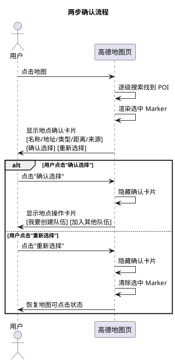

#### **8.5.5.3 异常场景**
1. **确认卡片展示时 selectedPoi 为 null**
a. 触发条件：因状态竞争导致显示确认卡片时 state.selectedPoi 已被清除
b. 系统行为：卡片不显示或立即隐藏，不报错
c. 用户感知：卡片不出现，地图保持可点击状态

2. **用户在确认卡片展示期间点击地图其他位置**
a. 触发条件：确认卡片可见时用户再次点击地图
b. 系统行为：若 isSearching 为 true 则忽略点击；搜索完成后新结果覆盖旧确认卡片
c. 用户感知：确认卡片更新为最新选中地点信息

### **8.5.6 [Phase 2B 详细展开] 创建队伍接入**

> **详细展开说明**：将现有 7.5.2 节概要需求展开为完整 EARS 需求，对应需求第六章。

#### **8.5.6.1 业务规则**

1. **[详细展开] [FR] [EARS: When]** 当用户在地点操作卡片中点击"我要创建队伍"时，系统须弹出创建队伍表单弹窗，表单须包含以下字段：出发地点、目的地、出发时间、人数限制、性别要求、备注。
a. 验收条件：[用户点击"我要创建队伍"] → [弹出创建队伍表单，含出发地点/目的地/出发时间/人数/性别/备注全部字段]

2. **[详细展开] [FR] [EARS: Ubiquitous]** 创建队伍表单中的目的地字段须自动填充为当前选中高德 POI 的名称（poi.name），且该字段为只读，用户不得手动修改目的地。
a. 验收条件：[创建队伍表单展示] → [目的地字段自动填充为 state.selectedPoi.name，字段为只读]

3. **[详细展开] [FR] [EARS: Ubiquitous]** 创建队伍表单中的出发地点须使用当前校区名称与出发入口名称组合（如"福州外语外贸学院滨海校区 · 学校入口"），复用现有 Leaflet 版 openCreateModal 逻辑。
a. 验收条件：[创建队伍表单展示] → [出发地点字段填充为校区名+入口名]

4. **[详细展开] [FR] [EARS: When]** 当用户填写完创建队伍表单并点击"创建"按钮时，系统须调用现有后端 API `POST /api/trips` 提交队伍数据，请求体须包含以下字段：origin、destination、departAt、seats、fee、originLat、originLng、destinationLat、destinationLng、gender、remark。
a. 验收条件：[用户点击"创建"] → [发起 POST /api/trips 请求，请求体含全部必填字段]

5. **[详细展开] [FR] [EARS: Ubiquitous]** 创建队伍提交时，destination 字段须使用当前选中高德 POI 的 name，destinationLat 须使用 poi.lat，destinationLng 须使用 poi.lng。
a. 验收条件：[创建队伍提交] → [destination = state.selectedPoi.name, destinationLat = state.selectedPoi.lat, destinationLng = state.selectedPoi.lng]

6. **[详细展开] [FR] [EARS: Ubiquitous]** 创建队伍提交时，前端状态须保留选中 POI 的完整信息（poiId、lng、lat、name、address、type），用于后续可能的队伍详情展示。
a. 验收条件：[创建队伍提交] → [前端 state 中保留 selectedPoi 的 id/lng/lat/name/address/type]

7. **[详细展开] [CONSTRAINT] [EARS: Ubiquitous]** 系统禁止因迁移高德地图而重建数据库。若现有数据库暂时没有 destination_poi_id / destination_address 等字段，Demo 第一版至少保证 destination = poi.name 并在前端状态保留 poiId、lng、lat。
a. 验收条件：[创建队伍成功] → [后端保存 destination 名称，前端保留 poiId/lng/lat，不重建数据库]

8. **[详细展开] [CONSTRAINT] [EARS: Ubiquitous]** 系统禁止重写后端创建队伍逻辑，须完全复用现有 `POST /api/trips` 接口与 `trip_service.create_trip` 服务。
a. 验收条件：[创建队伍功能] → [仅调用现有 POST /api/trips 接口，不新增后端接口，不修改 trip_service]

9. **[详细展开] [FR] [EARS: When]** 当创建队伍 API 返回成功（code === 0）时，系统须关闭创建表单弹窗，提示"队伍创建成功！"，并刷新队伍列表。
a. 验收条件：[POST /api/trips 返回 code=0] → [关闭弹窗、提示成功、刷新队伍列表]

10. **[详细展开] [FR] [EARS: When]** 当创建队伍 API 返回失败（code !== 0）时，系统须在创建表单弹窗内展示后端返回的错误消息，弹窗保持打开。
a. 验收条件：[POST /api/trips 返回 code≠0] → [弹窗内展示 data.message 错误提示，弹窗保持打开]

11. **[详细展开] [FR] [EARS: Ubiquitous]** 创建队伍表单须保留以下现有业务规则：出发时间须晚于当前时间、可拼人数须不小于 1、费用须为非负数值、性别要求取值范围为 {不限, 仅女生, 仅男生}、备注不超过 200 字。
a. 验收条件：[出发时间早于当前时间] → [后端返回"出发时间须晚于当前时间"错误，前端展示]
b. 验收条件：[可拼人数 < 1] → [后端返回"可拼人数须不小于 1"错误，前端展示]
c. 验收条件：[性别要求非法] → [后端返回"性别要求非法"错误，前端展示]

12. **[详细展开] [FR] [EARS: When]** 当用户在创建队伍表单中点击"取消"按钮时，系统须关闭创建表单弹窗，不提交任何数据。
a. 验收条件：[用户点击"取消"] → [创建表单弹窗关闭，不发起 API 请求]

#### **8.5.6.2 交互流程**
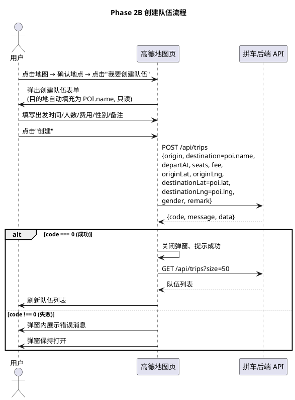

#### **8.5.6.3 异常场景**
1. **未选择出发入口**
a. 触发条件：用户在未选择校区出发入口的情况下点击"我要创建队伍"
b. 系统行为：弹出提示"请先选择出发入口"，不打开创建表单
c. 用户感知：看到"请先选择出发入口"提示

2. **出发时间为空或格式非法**
a. 触发条件：用户未填写出发时间或填写格式不正确
b. 系统行为：前端校验提示"请选择出发时间"，不发起 API 请求
c. 用户感知：看到"请选择出发时间"提示

3. **后端返回出发时间不晚于当前时间**
a. 触发条件：用户选择的出发时间已过去
b. 系统行为：后端返回 code=2001 "出发时间须晚于当前时间"，前端在弹窗内展示
c. 用户感知：弹窗内展示"出发时间须晚于当前时间"提示

4. **后端返回目的地不在服务范围**
a. 触发条件：选中 POI 坐标超出校区周边 40km 范围
b. 系统行为：后端返回 code=2002 "目的地不在服务范围内"，前端在弹窗内展示
c. 用户感知：弹窗内展示"目的地不在服务范围内"提示

5. **会话失效**
a. 触发条件：创建队伍时用户会话令牌已过期
b. 系统行为：API 返回 401，api 封装自动触发 showGuestOverlay
c. 用户感知：弹窗关闭，页面显示游客登录入口

6. **网络请求失败**
a. 触发条件：创建队伍请求因网络中断未达后端
b. 系统行为：api 封装返回 {code:9001, message:"响应解析失败"}
c. 用户感知：弹窗内展示"响应解析失败"提示，弹窗保持打开

### **8.5.7 [Phase 2C 详细展开] 加入队伍接入**

> **详细展开说明**：将现有 7.5.3 节概要需求展开为完整 EARS 需求，对应需求第七章。

#### **8.5.7.1 业务规则**

1. **[详细展开] [FR] [EARS: When]** 当用户在地点操作卡片中点击"加入其他队伍"时，系统须弹出加入队伍弹窗，展示与当前选中 POI 相关的队伍列表。
a. 验收条件：[用户点击"加入其他队伍"] → [弹出加入队伍弹窗，展示相关队伍列表]

2. **[详细展开] [FR] [EARS: When]** 当系统查询相关队伍时，须优先根据当前选中高德 POI 的 name 查找相同目的地的队伍（即 `t.destination === state.selectedPoi.name`）。
a. 验收条件：[加入队伍查询] → [以 state.selectedPoi.name 作为目的地过滤条件查询队伍]

3. **[详细展开] [FR] [EARS: Ubiquitous]** 系统须复用现有后端 API `GET /api/trips` 进行队伍查询，可通过 `?destination=` 查询参数按目的地名称过滤，不得新增后端接口。
a. 验收条件：[加入队伍查询] → [调用 GET /api/trips?destination={poi.name}，不新增后端接口]

4. **[详细展开] [FR] [EARS: When]** 当后端已有经纬度搜索能力时，系统可使用当前 POI 的 location（lng、lat）进行查询；否则 Demo 阶段继续使用目的地名称匹配。
a. 验收条件：[后端支持经纬度搜索] → [可使用 poi.lng/poi.lat 查询附近队伍]
b. 验收条件：[后端不支持经纬度搜索] → [使用 poi.name 名称匹配查询队伍]

5. **[详细展开] [CONSTRAINT] [EARS: Ubiquitous]** 系统禁止重写 trips API，加入队伍须完全复用现有 `GET /api/trips` 与 `POST /api/trips/{id}/join` 接口。
a. 验收条件：[加入队伍功能] → [仅调用现有 trips API，无新增后端接口，不修改 trip_service]

6. **[详细展开] [FR] [EARS: When]** 当查询返回的队伍列表为空时，系统须在加入队伍弹窗中展示"该地点暂无队伍，点击「创建队伍」发起一个吧"提示。
a. 验收条件：[查询返回 0 条队伍] → [弹窗展示"该地点暂无队伍，点击「创建队伍」发起一个吧"]

7. **[详细展开] [FR] [EARS: When]** 当查询返回的队伍列表非空时，系统须在弹窗中展示每个队伍的信息（目的地、出发地、出发时间、人数、性别要求、状态），并为可加入的队伍提供"加入"按钮。
a. 验收条件：[查询返回 N 条队伍（N>0）] → [弹窗展示每个队伍信息，可加入队伍显示"加入"按钮]

8. **[详细展开] [FR] [EARS: Ubiquitous]** 队伍可加入的判断条件为：状态为"待出发"且当前人数 < 最大人数（`t.status === "待出发" && t.currentSeats < t.maxSeats`）。
a. 验收条件：[队伍状态为"待出发"且有剩余座位] → [显示"加入"按钮]
b. 验收条件：[队伍状态非"待出发"或已满员] → [显示状态标签，不显示"加入"按钮]

9. **[详细展开] [FR] [EARS: When]** 当用户点击某队伍的"加入"按钮时，系统须调用现有后端 API `POST /api/trips/{id}/join` 加入该队伍。
a. 验收条件：[用户点击"加入"] → [发起 POST /api/trips/{tripId}/join 请求]

10. **[详细展开] [FR] [EARS: When]** 当加入队伍 API 返回成功（code === 0）时，系统须提示"加入成功！"，关闭加入弹窗，将 tripId 加入 joinedTripIds 集合并持久化，刷新队伍列表。
a. 验收条件：[POST /api/trips/{id}/join 返回 code=0] → [提示成功、关闭弹窗、joinedTripIds 添加 tripId、刷新列表]

11. **[详细展开] [FR] [EARS: When]** 当加入队伍 API 返回失败（code !== 0）时，系统须在加入弹窗内展示后端返回的错误消息，弹窗保持打开。
a. 验收条件：[POST /api/trips/{id}/join 返回 code≠0] → [弹窗内展示 data.message 错误提示，弹窗保持打开]

12. **[详细展开] [FR] [EARS: Ubiquitous]** 加入队伍须保留以下现有业务规则：不能加入自己的队伍、不能重复加入、性别要求校验、人数上限校验、座位抢占原子操作。
a. 验收条件：[用户加入自己创建的队伍] → [后端返回"不能加入自己的队伍"错误，前端展示]
b. 验收条件：[用户重复加入已加入的队伍] → [后端返回"已加入该队伍，请勿重复加入"错误，前端展示]
c. 验收条件：[性别不匹配] → [后端返回"该队伍仅限女生/男生加入"错误，前端展示]
d. 验收条件：[队伍已满员] → [后端返回"队伍已满员"错误，前端展示]

13. **[详细展开] [FR] [EARS: When]** 当用户在加入队伍弹窗中点击"关闭"按钮时，系统须关闭加入弹窗。
a. 验收条件：[用户点击"关闭"] → [加入弹窗关闭]

#### **8.5.7.2 交互流程**
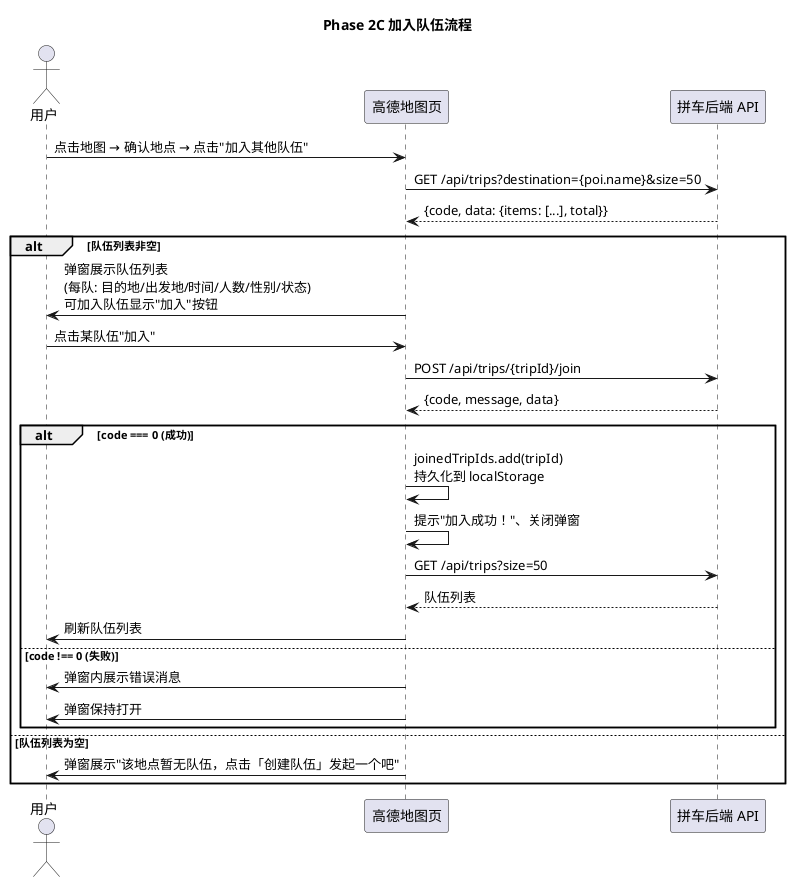

#### **8.5.7.3 异常场景**
1. **查询队伍列表失败**
a. 触发条件：GET /api/trips 请求因网络中断或服务异常失败
b. 系统行为：api 封装返回 {code:9001, message:"响应解析失败"}，弹窗展示错误
c. 用户感知：弹窗内展示"响应解析失败"提示

2. **加入自己的队伍**
a. 触发条件：用户尝试加入自己创建的队伍
b. 系统行为：后端返回 code=3002 "不能加入自己的队伍"，前端在弹窗内展示
c. 用户感知：弹窗内展示"不能加入自己的队伍"提示

3. **重复加入**
a. 触发条件：用户尝试加入已加入的队伍
b. 系统行为：后端返回 code=3003 "已加入该队伍，请勿重复加入"
c. 用户感知：弹窗内展示"已加入该队伍，请勿重复加入"提示

4. **性别不匹配**
a. 触发条件：用户性别与队伍性别要求不匹配（如男生加入仅女生队伍）
b. 系统行为：后端返回 code=3005 "该队伍仅限女生/男生加入"
c. 用户感知：弹窗内展示性别限制提示

5. **队伍已满员**
a. 触发条件：队伍 currentSeats >= maxSeats
b. 系统行为：后端返回 code=3001 "队伍已满员"
c. 用户感知：弹窗内展示"队伍已满员"提示

6. **队伍已结束**
a. 触发条件：队伍状态为已出发/已完成/已取消
b. 系统行为：后端返回 code=9003 "队伍已结束，无法加入"
c. 用户感知：弹窗内展示"队伍已结束，无法加入"提示

7. **会话失效**
a. 触发条件：加入队伍时用户会话令牌已过期
b. 系统行为：API 返回 401，api 封装自动触发 showGuestOverlay
c. 用户感知：弹窗关闭，页面显示游客登录入口

### **8.5.8 [改进] 选中地点 Marker 管理**

> **改进说明**：重申并强化选中 Marker 单例管理规则，对应需求第九章。

#### **8.5.8.1 业务规则**

1. **[改进] [FR] [EARS: When]** 当用户成功选择一个高德 POI 后，系统须允许临时添加一个选中 Marker，用于告知用户"你当前选择的是这里"。
a. 验收条件：[用户点击地图并成功识别 POI] → [地图上出现一个选中 Marker 标记该 POI 位置]

2. **[改进] [FR] [EARS: Ubiquitous]** 选中地点 Marker 须使用 Campus map 自定义高亮样式（绿色水滴形图标），与高德原生 POI 图标视觉区分。
a. 验收条件：[选中 Marker 渲染] → [Marker 使用自定义绿色高亮样式，可辨识为"当前选中"标记]

3. **[改进] [CONSTRAINT] [EARS: While]** 在任意时刻，系统须仅显示一个当前选中地点 Marker，禁止同时显示多个选中 Marker。
a. 验收条件：[用户连续点击多个地点] → [地图上始终仅存在最新一个选中 Marker]

4. **[改进] [FR] [EARS: When]** 当用户选择另一个地点时，系统须移除旧选中 Marker，仅保留最新一个。
a. 验收条件：[已存在选中 Marker 时用户点击新地点] → [旧 Marker 被移除，新 Marker 渲染于最新选中位置]

5. **[改进] [CONSTRAINT] [EARS: Ubiquitous]** 系统禁止重新绘制地图上所有 POI 作为选中 Marker，选中 Marker 仅对应当前用户选择的单一地点。高德原生 POI 图标继续由高德显示。
a. 验收条件：[用户选择地点] → [仅渲染 1 个选中 Marker，不触发全量 POI 绘制]

6. **[改进] [FR] [EARS: When]** 当用户点击"重新选择"或关闭确认卡片时，系统须移除当前选中 Marker。
a. 验收条件：[用户点击"重新选择"或关闭] → [选中 Marker 被移除，state.selectedMarker 与 state.selectedPoi 均为 null]

### **8.5.9 [CONSTRAINT] 保留已有业务规则**

> **对应需求第八章，确保地图迁移不破坏现有功能。**

#### **8.5.9.1 业务规则**

1. **[CONSTRAINT] [EARS: Ubiquitous]** 系统须保留用户昵称功能，游客进入时输入昵称即可使用，昵称长度不超过 20 字。
a. 验收条件：[Phase 2 改进上线] → [游客进入昵称功能正常工作]

2. **[CONSTRAINT] [EARS: Ubiquitous]** 系统须保留性别功能，性别要求取值范围为 {不限, 仅女生, 仅男生}，创建队伍时可设置，加入队伍时校验。
a. 验收条件：[Phase 2 改进上线] → [性别要求设置与校验正常工作]

3. **[CONSTRAINT] [EARS: Ubiquitous]** 系统须保留人数上限功能，创建队伍时可设置最大可拼人数，加入队伍时校验是否已满员。
a. 验收条件：[Phase 2 改进上线] → [人数上限设置与满员校验正常工作]

4. **[CONSTRAINT] [EARS: Ubiquitous]** 系统须保留出发时间功能，创建队伍时须设置出发时间且晚于当前时间。
a. 验收条件：[Phase 2 改进上线] → [出发时间设置与校验正常工作]

5. **[CONSTRAINT] [EARS: Ubiquitous]** 系统须保留备注功能，创建队伍时可填写备注，备注长度不超过 200 字。
a. 验收条件：[Phase 2 改进上线] → [备注功能正常工作]

6. **[CONSTRAINT] [EARS: Ubiquitous]** 系统须保留加入队伍功能，用户可加入他人创建的队伍。
a. 验收条件：[Phase 2 改进上线] → [加入队伍功能正常工作]

7. **[CONSTRAINT] [EARS: Ubiquitous]** 系统须保留退出队伍功能，已加入的非队长乘客可退出队伍。
a. 验收条件：[Phase 2 改进上线] → [退出队伍功能正常工作]

8. **[CONSTRAINT] [EARS: Ubiquitous]** 系统须保留已满状态功能，队伍人数达到上限时状态变更为"已满员"。
a. 验收条件：[Phase 2 改进上线] → [已满状态自动变更正常工作]

9. **[CONSTRAINT] [EARS: Ubiquitous]** 地图迁移不得破坏上述任何现有功能，所有现有业务规则在 Phase 2 改进上线后须继续正常工作。
a. 验收条件：[Phase 2 改进上线后全面回归测试] → [所有现有业务功能正常，无回归]

## **8.6 数据约束（增量）**

### **8.6.1 逐级搜索配置**
1. **searchRadiusLevels**：逐级搜索半径序列，固定为 [100, 300, 500]（单位：米），不得使用其他数值。
2. **poiTypeList**：多类型 POI 查询类型列表，至少包含十种类型：餐饮服务、购物服务、科教文化服务、医疗保健服务、生活服务、体育休闲服务、住宿服务、交通设施服务、风景名胜、公司企业。

### **8.6.2 地点确认卡片数据**
1. **name**：地点名称，取自选中高德 POI 的 name 字段，非空字符串。
2. **address**：地址，取自选中高德 POI 的 address 字段，可为空，展示时为空显示"—"。
3. **type**：地点类型，取自选中高德 POI 的 type 字段，可为空，展示时为空显示"—"。
4. **distance**：距离点击位置的米数，非负数值，由 calcDistance 计算得出，展示时按 8.5.5.1 规则 8 格式化。
5. **source**：数据来源，固定为"高德地图"。

### **8.6.3 创建队伍表单数据（Phase 2B 详细）**
1. **origin**：出发地点，字符串，由校区名称与出发入口名称组合而成。
2. **destination**：目的地，字符串，取自选中高德 POI 的 name 字段，字段只读。
3. **departAt**：出发时间，ISO 格式字符串，须晚于创建时当前时间。
4. **seats**：可拼人数，正整数，范围 [1, 8]。
5. **fee**：费用，可为 null 表示免费，非 null 时须为非负数值。
6. **gender**：性别要求，取值范围为 {不限, 仅女生, 仅男生}。
7. **remark**：备注，可为 null，非 null 时长度不超过 200 字。
8. **originLat / originLng**：出发地经纬度，取自当前校区出发入口坐标。
9. **destinationLat**：目的地纬度，取自选中高德 POI 的 lat 字段。
10. **destinationLng**：目的地经度，取自选中高德 POI 的 lng 字段。

### **8.6.4 前端选中 POI 状态保留**
1. **selectedPoi.id**：高德 POI 唯一标识，前端状态保留，Demo 阶段可不传后端。
2. **selectedPoi.name**：地点名称，创建队伍时作为 destination 提交后端。
3. **selectedPoi.lng**：经度，创建队伍时作为 destinationLng 提交后端。
4. **selectedPoi.lat**：纬度，创建队伍时作为 destinationLat 提交后端。
5. **selectedPoi.address**：地址，前端状态保留，Demo 阶段可不传后端。
6. **selectedPoi.type**：地点类型，前端状态保留，用于卡片展示。

## **8.7 不修改范围（约束清单 - 增量）**

> **以下为本次 Phase 2A 改进 + Phase 2B + Phase 2C 明确不修改的范围，作为约束强制执行。**

1. **[CONSTRAINT]** 不修改后端 API：`app/api/trips.py`、`app/services/trip_service.py` 不做任何改动，创建/加入/搜索/退出/状态流转接口全部复用。
2. **[CONSTRAINT]** 不重建数据库：SQLite schema 不变，不新增表、不新增字段、不重建结构。Demo 第一版创建队伍至少保存目的地名称与经纬度即可。
3. **[CONSTRAINT]** 不修改现有 Leaflet 版地图页：`static/map.html`、`static/map.js` 不做任何改动。
4. **[CONSTRAINT]** 不修改论坛模块：论坛、帖子、评论、点赞相关代码与页面不做任何改动。
5. **[CONSTRAINT]** 不修改游客进入机制：游客身份、性别选择、会话令牌逻辑复用现有实现，不做改动。
6. **[CONSTRAINT]** 不删除 `osm_pois.json`：该文件保留，但高德正式页面不主动加载和绘制其中全部 POI。
7. **[CONSTRAINT]** 不人为生成地点数据：所有展示的地点名称、坐标、地址、类型须来自高德 PlaceSearch 真实返回，禁止前端伪造。
8. **[CONSTRAINT]** 不批量绘制自定义 POI Marker：高德正式页面不再将 `osm_pois.json` 全部地点绘制为自定义 Marker，普通地点使用高德原生显示效果。
9. **[CONSTRAINT]** 优先仅修改前端三文件：`static/map_amap.js`、`static/map_amap.css`、必要时 `static/map_amap.html`。除非实际接口调用存在明确兼容问题，否则不修改其他文件。
10. **[CONSTRAINT]** 不修改首页入口：Phase 2A/2B/2C 全部人工验收通过前，首页"进入地图"入口保持指向 `/map.html`，禁止提前切换。

## **8.8 正式验收场景**

> **对应需求第十一章，定义人工验收的端到端场景。**

### **8.8.1 验收场景定义**

1. **[FR] [EARS: Ubiquitous]** 须至少验证高德地图当前页面中真实可见的多个地点（例如长乐校区页面：图书馆、体育馆、餐厅、便利店、酒店），人工点击这些地点附近进行验收。
a. 验收条件：[长乐校区地图页加载完成] → [底图上可见图书馆、体育馆、餐厅、便利店、酒店等高德原生地点]

2. **[FR] [EARS: When]** 当用户点击高德底图上可见地点附近时，须完成以下端到端流程：点击 → 逐级搜索识别真实高德 POI → 显示地点确认卡片 → 点击"确认选择" → 显示地点操作卡片 → 点击"我要创建队伍" → 填写表单 → 创建队伍成功 → 队伍列表可以看到新创建的队伍。
a. 验收条件：[用户点击图书馆附近] → [识别到图书馆 POI → 确认卡片 → 确认 → 操作卡片 → 创建队伍 → 队伍列表出现新队伍]
b. 验收条件：[用户点击体育馆附近] → [识别到体育馆 POI → 确认卡片 → 确认 → 操作卡片 → 创建队伍 → 队伍列表出现新队伍]
c. 验收条件：[用户点击餐厅附近] → [识别到餐厅 POI → 确认卡片 → 确认 → 操作卡片 → 创建队伍 → 队伍列表出现新队伍]
d. 验收条件：[用户点击便利店附近] → [识别到便利店 POI → 确认卡片 → 确认 → 操作卡片 → 创建队伍 → 队伍列表出现新队伍]
e. 验收条件：[用户点击酒店附近] → [识别到酒店 POI → 确认卡片 → 确认 → 操作卡片 → 创建队伍 → 队伍列表出现新队伍]

3. **[FR] [EARS: When]** 当用户点击高德底图上可见地点附近并完成确认后，点击"加入其他队伍"须完成以下流程：点击"加入其他队伍" → 显示该目的地相关队伍列表 → 点击"加入" → 加入成功 → 队伍列表更新。
a. 验收条件：[已创建图书馆队伍后另一用户点击图书馆附近 → 确认 → 加入其他队伍] → [队伍列表显示图书馆队伍 → 点击加入 → 加入成功 → 列表更新]

4. **[FR] [EARS: When]** 当用户点击高德底图上无明显地点的区域时，须显示"附近暂未识别到明确地点，请点击更靠近地点名称或图标的位置。"提示。
a. 验收条件：[用户点击偏远无地点区域] → [显示"附近暂未识别到明确地点，请点击更靠近地点名称或图标的位置。"提示]

5. **[FR] [EARS: When]** 当用户在地点确认卡片中点击"重新选择"时，须清除选中 Marker 并恢复地图可点击状态，用户可重新点击其他地点。
a. 验收条件：[用户点击地点 → 确认卡片 → 重新选择] → [Marker 清除、地图恢复可点击、可重新点击其他地点]

### **8.8.2 验收前置条件**

1. 高德地图 Key 已正确配置，地图可正常加载。
2. 用户已通过游客进入机制登录（有昵称、性别、令牌）。
3. 后端服务正常运行，`POST /api/trips`、`GET /api/trips`、`POST /api/trips/{id}/join` 接口可用。
4. 已选择校区出发入口（如"福州外语外贸学院长乐校区 · 学校入口"）。

### **8.8.3 验收后置条件**

1. 创建的队伍在队伍列表中可见，包含正确的目的地名称。
2. 加入的队伍在队伍列表中状态更新（人数+1）。
3. 所有操作不产生 JavaScript 报错或白屏。
4. 现有 Leaflet 版地图页（`/map.html`）功能不受影响。